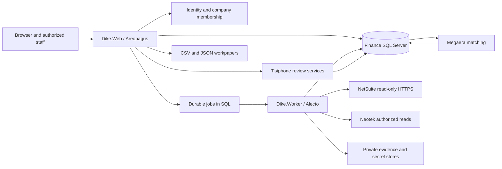
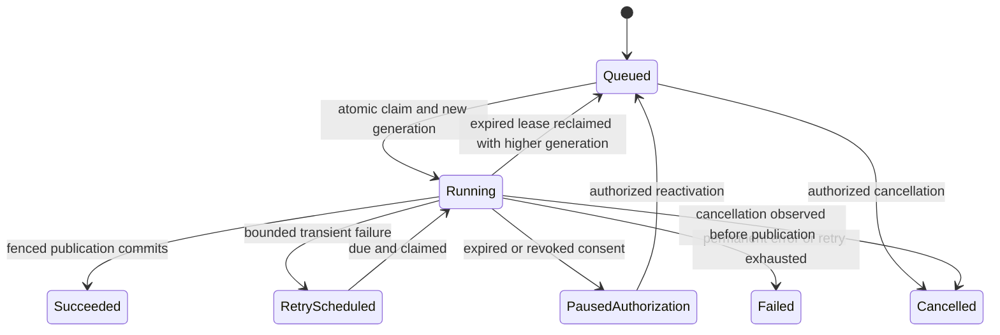

# Dike full product specification and implementation plan

Author: Ahmed Ali Refaey  
Prepared: 5 November 2026  
Version: 0.1  
Status: Complete consolidated draft for review; architecture options and external acceptance gates remain open  
Evidence baseline: source documents dated 4 November 2026, with limited read-only source inspection on 5 November 2026

This document defines the first Dike reconciliation release, the work needed to finish it, and the evidence required to accept it. It combines all seven supplied sources. Dike compares authorized bank activity with posted NetSuite bank-ledger movements and records human review decisions. It does not move money or change the accounting system.

The product scope and controls below carry forward the supplied requirements. Details marked **Proposed** fill implementation gaps and require review. Details marked **Open** need an owner decision or provider evidence. A complete draft is not an approved implementation design, a live integration test, or a production-readiness claim.

## Contents

1. [Source baseline and reconciliation](#1-source-baseline-and-reconciliation)
2. [Problem goals and release boundaries](#2-problem-goals-and-release-boundaries)
3. [Actors and authorization](#3-actors-and-authorization)
4. [Critical user journeys](#4-critical-user-journeys)
5. [Functional specification](#5-functional-specification)
6. [Architecture and component boundaries](#6-architecture-and-component-boundaries)
7. [Data and accounting contracts](#7-data-and-accounting-contracts)
8. [Provider and ingestion contracts](#8-provider-and-ingestion-contracts)
9. [Matching and review transactions](#9-matching-and-review-transactions)
10. [Durable jobs and snapshot publication](#10-durable-jobs-and-snapshot-publication)
11. [Screens actions and evidence](#11-screens-actions-and-evidence)
12. [Security and operational requirements](#12-security-and-operational-requirements)
13. [Alternatives and decisions requiring review](#13-alternatives-and-decisions-requiring-review)
14. [Detailed implementation plan](#14-detailed-implementation-plan)
15. [Verification and release acceptance](#15-verification-and-release-acceptance)
16. [Traceability risks and handover](#16-traceability-risks-and-handover)

## 1 Source baseline and reconciliation

### 1.1 Source register

| ID | Supplied source | How it is used |
| --- | --- | --- |
| S1 | [Dike ASP NET Core Design and Plan](./Dike_ASPNET_Core_Design_and_Plan.docx) | Product intent, module boundaries, accounting controls, user journeys, original six-phase estimate and acceptance requirements. The workspace copy is byte-identical to the supplied Downloads copy. |
| S2 | [Company registration](./docs/COMPANY_REGISTRATION.md) | Current direct Identity login, onboarding, session/password behavior and outstanding identity work. |
| S3 | [Database configuration](./docs/DATABASE_CONFIGURATION.md) | Actual storage boundaries, connection configuration, migration gaps, key backup and restore requirements. |
| S4 | [Implementation plan](./docs/IMPLEMENTATION_PLAN.md) | Existing foundation, implementation sequence, missing prerequisites and exclusions. |
| S5 | [NetSuite connector](./docs/NETSUITE_CONNECTOR.md) | Implemented authentication/query behavior, narrow accounting scope, paging, failure behavior and live acceptance gates. |
| S6 | [OIDC setup](./docs/OIDC_SETUP.md) | Historical design evidence only. Its superseded banner is authoritative; old configuration is not an active setup requirement. |
| S7 | [Project status](./docs/PROJECT_STATUS.md) | Authoritative reported completion register and explicit baseline deviations. Local checks are not finance acceptance. |

Source precedence is contextual: S7 establishes reported delivery state; S2, S3 and S5 describe the current implementation in detail; S1 supplies product requirements not explicitly superseded. S4 supplies the unfinished backlog. S6 cannot reactivate OIDC. Document instructions and example commands are source material, not authorization to deploy, connect providers, migrate data or change code.

Read-only inspection also covered the current domain models, matcher, review policy, finance context, Identity context, application/worker startup, NetSuite authentication definitions, test project and README. Inspection established file-level planning context only. No build, application test, live provider request or database migration was performed while preparing this draft. No AGENTS.md was found in the checked workspace/parent locations. The workspace is not currently recognized as a Git repository, so no clean-worktree claim is made.

### 1.2 Resolved deviations from the original design

| Original statement | Current interpretation | Planning consequence |
| --- | --- | --- |
| Company OIDC and organization MFA | S2/S7 explicitly replace website OIDC with direct company registration and ASP.NET Core Identity | Finish email verification, recovery, invitations and MFA for direct Identity. Do not require an OIDC authority or client secret. |
| Reuse a working NetSuite client | S4/S5/S7 say no existing client was supplied; a new adapter exists | Harden and validate the existing adapter; do not assume a separately supplied working integration. |
| Shared SQL Server persistence | Identity is SQLite; connector state/evidence are encrypted files; finance SQL is unconfigured | Preserve existing data and keys. Plan reviewed finance migrations and publication, then decide production topology. |
| Worker performs imports | Worker is deliberately idle; current NetSuite collection is synchronous | Build durable jobs and fenced publication before unattended or multi-instance processing. |
| One company pilot | Registration and connector state are company-separated | Keep one company in finance acceptance while proving cross-company denial with test tenants. Company switching remains outside the initial user model. |
| One accounting book and SAR | Current connector additionally requires the primary book and SAR subsidiary base currency | Preserve those guards; secondary books and foreign-currency mapping require a separate approved change. |
| Six weeks | Original conditional estimate, not elapsed time or an approved delivery date | Track deliverable gates and dependencies; re-estimate after provider and storage decisions. |

### 1.3 Existing implementation versus required completion

| Capability | Evidence baseline | Remaining release work |
| --- | --- | --- |
| Company login/profile/password change | Implemented and locally checked | Verification/recovery, invitations, staff roles, MFA, abuse controls, production identity operations |
| NetSuite configuration and manual extraction | Fixture-tested implementation | Live credentials/permissions, field and line-key validation, GL agreement, durable SQL publication |
| Finance schema | Initial EF models and indexes | Complete logical model, constraints, reviewed migrations and deployed database |
| Matching and review | Pure rules and initial entity definitions | Persisted proposals, transactional transitions, permissions, concurrency and invalidation |
| CSV and Neotek | Provider contracts only | Confirm source contracts, implement all-page ingestion, consent lifecycle and replay |
| Worker | Host lifecycle only; processing disabled | Claims, leases, renewal, fencing, retry, scheduling and recovery |
| UI | Registration/company/connection screens and extract preview | Account overview, reconciliation grids, exceptions, workpapers and complete accessibility checks |
| Production operations | Requirements described | Approved stores/hosting/retention, backup restoration, observability and finance acceptance |

## 2 Problem goals and release boundaries

### 2.1 The problem

Finance needs an auditable way to compare bank-reported transactions with posted cash-account movements without confusing a proposed match with an accounting correction or an official bank reconciliation. Separate source systems can publish late entries, pending transactions, corrections and incomplete extracts. A comparison is trustworthy only when its account scope, source coverage, versions and human review are visible.

### 2.2 Goals

- G01: Validate NetSuite bank GL inputs against a finance-approved report for the selected subsidiary, primary book, SAR account and statement period.
- G02: Import authorized bank transactions and typed balances, with a confirmed CSV fallback and no silent partial publication.
- G03: Produce reproducible, explainable proposals using exact signed amounts, nonempty normalized references and the existing three-business-day rule.
- G04: Support exact whole-row one-to-one, one-to-many and many-to-one review groups with distinct preparer and controller.
- G05: Prevent duplicate consumption of a source row and invalidate decisions whose source evidence changes.
- G06: Expose freshness, failed imports, unresolved exceptions and account-specific bank/book movements without inventing balance agreement.
- G07: Export reproducible CSV workpapers and JSON evidence with source runs, revisions, decisions and review history.
- G08: Demonstrate isolation, safe replay/restart, restoration and finance acceptance for two SAR accounts.

### 2.3 First release boundary

Acceptance uses one company, one legal entity/subsidiary, one primary accounting book, two SAR bank accounts mapped to distinct NetSuite bank GL accounts, and one agreed statement period. Company-separated infrastructure must still deny access between test companies. Staff belong to one company each; email uniqueness remains global in this initial model.

Accessible active chart-of-accounts metadata supports selection. Detailed import is limited to eligible bank GL postings. NetSuite is authoritative for book facts, the bank/provider for bank facts, and Dike for comparison proposals, exceptions and internal review decisions. A Dike Approved status is never presented as NetSuite cleared/reconciled status.

### 2.4 Non-goals

Payment initiation, automatic journals, accounting-record mutations, official NetSuite reconciliation writeback, partial monetary allocations, many-to-many approval groups, multicurrency consolidation, forecasts, detailed invoice/bill application chains and a native SuiteScript parser are outside this release. Company switching, secondary-book support and general non-bank reporting need a later design. Slack/email exception notifications and holiday calendars remain later work; identity verification/recovery email is a separate production requirement.

## 3 Actors and authorization

Roles are action permissions, not a substitute for company/subsidiary/account grants. Each request derives CompanyId from the authenticated database membership. Client-supplied tenant identifiers never select authority. Background jobs carry an immutable company/account scope and use a separately authorized service execution context.

| Action | Administrator | Accountant | Controller | Viewer |
| --- | --- | --- | --- | --- |
| Company profile, connections and mapping administration | Yes, within company | No | No unless separately Administrator | No |
| Staff invitations and assignment of approved grants | Yes, with audited controls | No | No unless separately Administrator | No |
| Read account overview and approved reports | Only with read grant | With read grant | With read grant | With read grant |
| Request synchronization | With sync grant | With sync grant | With sync grant | No |
| Prepare groups and investigate exceptions | Only if separately Accountant | Yes, with account write grant | Only if separately Accountant | No |
| Approve, return or reopen | Only if separately Controller | No | Yes, with account grant and different user from preparer | No |
| Export financial evidence | Explicit export grant | Explicit export grant | Explicit export grant | Explicit export grant; report visibility alone does not grant raw evidence |

The detailed grant matrix above is **Proposed** where the sources name roles but do not specify each permission. Administrator must not implicitly bypass the distinct-approver check. If a person holds Accountant and Controller, that person still cannot approve their own prepared group. Role-assignment escalation controls require decision D02 before implementation.

Authorization must cover list queries, detail pages, related object traversal, downloads, submission, status changes, jobs, mapping changes and exports. Resolving a valid group ID is insufficient without checking its company and mapping. Foreign-company resources must not disclose names, balances, row counts or existence through errors. Recheck permissions when executing a financial action and when delivering a generated export.

## 4 Critical user journeys

| ID | Given | When | Then |
| --- | --- | --- | --- |
| CUJ01 Register and onboard | No user exists for the normalized email | Owner registers and self-attests authority | Company/user/Administrator association commit together; failure leaves no orphan company; incomplete profile routes to setup; email is not falsely marked verified. |
| CUJ02 Prepare two-person review | Owner has a company and production identity delivery is available | Administrator invites an accountant and a distinct controller and assigns account grants | Accepted, verified staff can access only assigned resources; the company now has an eligible preparer/controller pair. |
| CUJ03 Validate accounting input | Administrator has permitted NetSuite integration access | They configure credentials, collect account metadata and extract one period | Eligible scope is checked, all pages validate and report totals/identities are compared with the GL report before activation. |
| CUJ04 Link and map bank accounts | Supported corporate bank links and authorization exist | Authorized user links two accounts and administrator validates mappings | Each account maps to a different verified bank GL in the intended subsidiary/book/currency; mapping versions are retained. |
| CUJ05 Import a bank statement | A confirmed CSV contract and selected mapping exist | Accountant uploads the statement | File/schema/scope/precision/identity validations pass before publication; duplicate replay adds no duplicate movements; errors preserve prior coverage. |
| CUJ06 Recover a failed sync | A prior completed source snapshot is visible | A later import fails on page two or authorization expires | The old snapshot remains current, freshness/failure is visible, coverage does not advance and no rows are inferred deleted. |
| CUJ07 Reconcile ordinary movements | Current complete bank/book snapshots exist | Accountant opens the account/period and requests proposals | Explainable proposals are shown; pending, ambiguous and amount-mismatch items do not silently become approved. |
| CUJ08 Review a balanced group | Eligible unreserved rows share one scope and balance exactly | Accountant submits; a distinct controller approves | Version and reservation checks succeed atomically, audit evidence is stored and rows cannot be consumed by another active group. |
| CUJ09 Handle conflicting approvals | Two groups reference at least one common logical source row | Concurrent actions attempt to reserve/approve | At most one succeeds; the other returns a conflict and rolls back all state and audit writes for that failed action. |
| CUJ10 Handle source corrections | An approved group references an older source revision | A complete refresh changes or proves removal of a member | The decision is invalidated, reservations released, history retained and a visible exception requires new review. |
| CUJ11 Investigate SAR 50 | Bank receipt is +5,000 and book receipt is +5,050 | Accountant investigates the difference | Dike displays an amount mismatch; no fee is inferred. Evidence and any accounting correction come from finance; incompatible split-fee rows remain unresolved under existing grouping rules. |
| CUJ12 Reopen and export | A controller can access an approved group | They reopen with a reason or export an authorized workpaper | Reopening preserves prior approval history; export captures a consistent revision with source runs, totals, group states and audit events. |
| CUJ13 Restore service | Approved backup set includes Identity, finance, evidence and keys | Operations restores into an isolated environment | Users/scopes/history/evidence remain consistent, evidence decrypts and expired jobs recover without duplicate publication. |

## 5 Functional specification

All requirements below are target behavior, not completion claims. Provenance refers to the source register. Proposed implementation details remain subject to the decision register.

### 5.1 Identity and company lifecycle

| ID | Requirement | Evidence and completion condition |
| --- | --- | --- |
| IDN01 | Register company, owner and initial Administrator in one Identity transaction; reject duplicate normalized emails | S2/S7; concurrent duplicates and validation failures leave no orphan company/user. |
| IDN02 | Preserve company profile fields: name, country, currency, registration number, address and setup-complete state | Current Identity model; only the signed-in user's company can be edited. Registration number is not proof of verification. |
| IDN03 | Retain twelve-character password policy with uppercase/lowercase/digit/symbol, five-attempt lockout for fifteen minutes and a one-hour non-sliding session | S2 and startup inspection; logout/change-password remain CSRF protected and return URLs local-only. |
| IDN04 | Add email verification, recovery and invitations using expiring single-purpose tokens and configured delivery | S2/S7; reject expired/replayed tokens, avoid account enumeration and never email passwords. Delivery provider is D01/D09 dependent. |
| IDN05 | Add membership administration and granular grants without allowing assignment outside the current company | S4/S7; test revoked membership, foreign identifiers and privilege escalation. |
| IDN06 | Complete registration throttling and MFA policy before public production launch | S2/S7; choose enrollment/recovery and administrative policy through D02. |

### 5.2 Connections and mappings

| ID | Requirement | Evidence and completion condition |
| --- | --- | --- |
| CON01 | NetSuite credentials remain company-scoped, server-side, encrypted and never redisplayed | S5; masked metadata can be shown; secrets do not appear in URLs, logs or exported workpapers. |
| CON02 | Preserve TBA HMAC-SHA256 and RSA/PS256 M2M modes and reject unsupported authentication modes | S5; M2M requires mapped certificate and private key, not a client secret alone. |
| CON03 | Derive the allowed HTTPS SuiteTalk destination from validated account ID and reject redirects | S5; arbitrary URL input or redirect cannot change the destination. |
| CON04 | Record bank authorization separately from application credentials, including state and expiry where supplied | S1; pause affected bank jobs on revocation/expiry without deleting historical evidence. |
| MAP01 | Version the verified relationship between bank account, NetSuite connection/GL account, subsidiary, primary book and SAR currency | S1/S5; preserve historical mapping versions and record verifier/time/evidence. |
| MAP02 | Activate only after account ownership, currency, scope and source contracts are verified | S1/S5; metadata listing alone is not proof of a valid account/subsidiary/book mapping. |
| MAP03 | Preserve canonical source identity and audit history when mapping/configuration changes | Proposed detail of S1/S5; never silently merge old extracts with a new connection or silently move approved groups. |

### 5.3 Ingestion and durable processing

| ID | Requirement | Evidence and completion condition |
| --- | --- | --- |
| ING01 | Stage and validate every required page before publishing a snapshot | S1/S5; failed, incomplete, duplicate-key or scope-invalid extraction cannot replace the current snapshot. |
| ING02 | Preserve original source IDs, signed values, status, dates, references, source evidence and immutable versions | S1; repeat imports distinguish unchanged replay from actual correction. |
| ING03 | Store provider balances separately with type, currency, as-of time and fetch time | S1; missing source timestamp remains unknown, not substituted by fetch time. |
| ING04 | Implement confirmed CSV fallback and Neotek accounts/balances/transactions | S1/S4; endpoint, authorization and schema details come from actual subscribed contracts. |
| ING05 | Treat disappearance as removal only after a complete equivalent-scope authoritative refresh | S1/S4; partial/delta/CSV subsets and failure do not prove deletion. |
| JOB01 | Queue manual and scheduled work durably, claim with leases and reject stale publication | S1/S4; crash/reclaim tests prove at-most-one current publication despite repeated execution. |
| JOB02 | Serialize conflicting imports and honor quota, retry, consent and cancellation states | S1/S4; lock/fencing scope survives mapping changes and is not limited to one process. |
| JOB03 | Enable a configurable 15-minute schedule only after provider approval; add overlap/full-period refresh policies | S1; interval, overlap length, full-refresh cadence and stale threshold need D05 evidence. |

### 5.4 Comparison review and evidence

| ID | Requirement | Evidence and completion condition |
| --- | --- | --- |
| MAT01 | Propose only within one mapped company/subsidiary/book/account/currency and between booked bank/posted book rows | S1/current matcher; no cross-account or pending proposals eligible for approval. |
| MAT02 | Preserve exact amount/reference/date classification and versioned explanations | S1/current matcher; same inputs and rule version produce the same ordered results. |
| REV01 | Accept only whole-row, nonzero, same-direction balanced 1:1, 1:N or N:1 groups, with a reason | S1/current policy; N:N and partial allocations fail; tolerance is exactly zero. |
| REV02 | Enforce distinct preparer/controller, current versions and one active reservation per logical source row | S1/S4; transactional concurrency tests, not in-memory policy checks, establish completion. |
| REV03 | Implement submit, approve, return, reopen and invalidation with immutable revision history and payload-bound idempotency | S1/S4; actions cannot leave partial groups, memberships or audit events. |
| EXC01 | Track exceptions by scope, category, owner, age, evidence, notes and resolution reason | S1; an exception resolution never fabricates a source correction or approved match. |
| EVD01 | Export scoped CSV/JSON workpapers from one consistent captured revision | S1; include runs, coverage, source versions, signed totals, rules, group history and unresolved items. |
| OPS01 | Make stale/failed/incomplete data and unverified provider inputs visible | S1/S7; no misleading live, real-time, reconciled or production-ready indicator. |
| OPS02 | Restore Identity, finance, encrypted evidence and keys together and validate recovery | S3/S7; tested restoration and operations handover are mandatory release gates. |

## 6 Architecture and component boundaries

### 6.1 Retained solution design

Retain the existing .NET 10 ASP.NET Core solution, Razor Pages and EF Core. SQL Server remains the specified finance store. Keep Alecto, Megaera, Tisiphone and Areopagus as module responsibilities inside one solution; the sources do not require separate microservices.

This is the target runtime. Today, company-scoped NetSuite collection runs inside the web process and writes encrypted local files. The worker does not process jobs. The transition must retain the existing pilot evidence until SQL publication and recovery are validated.

| Project | Target responsibility | Boundary |
| --- | --- | --- |
| Dike.Core | Pure accounting contracts, matching rules, review rules and provider/service ports | No database, network, UI or secret-store calls from matching/review policies. |
| Dike.Infrastructure | Provider adapters, finance persistence, leases, ingestion, transactional review, evidence and exports | All data actions require an explicit validated scope; provider facts are normalized here, not fabricated by the UI. |
| Dike.Web | Identity/company setup, Razor screens, resource authorization and command/query entry points | Resolve user/company server-side; keep handlers thin; enqueue long imports. |
| Dike.Worker | Job dispatch, renewal, retry and scheduling | Same scoped persistence contracts as web actions; no trusting serialized browser claims. |
| Dike.Tests | Existing executable checks plus connector, SQL concurrency, security and export checks | Real SQL semantics must be tested against SQL Server, not inferred from in-memory tests. |

### 6.2 Application service contracts

The following are **Proposed** contract boundaries; names describe future files in section 14. They do not imply new public HTTP APIs or additional deployable services.

- Scope authorization resolves the current user/company, requested action and granted account before querying or mutating resources. Worker scope is loaded from trusted job/connection records and current authorization state.
- Connection and mapping services validate configuration metadata, version changes and activation evidence. They expose secret references, never secret values in normal read models.
- Ingestion services create runs, stage source pages, validate completeness, compute immutable versions and request publication.
- Snapshot publication atomically installs the new current generation, adjusts coverage and invalidates affected decisions, guarded by the current job lease.
- Proposal services run the pure matcher against specified current bank/book snapshot generations and persist rule/explanation context.
- Review services perform submission and transitions in finance SQL transactions. The pure ReviewPolicy remains a reusable validator, not the concurrency boundary.
- Workpaper services capture an authorized consistent read, serialize evidence and record export audit metadata.

### 6.3 Storage topology

Keep these distinctions explicit: Identity currently uses SQLite; finance requires SQL Server; connector credentials and extracts currently use purpose-isolated Data Protection encrypted files. Setting ConnectionStrings:Identity to a SQL Server-shaped string does not switch its provider. Setting ConnectionStrings:Dike does not create tables or migrate connector files.

The production Identity location, evidence store and secrets provider are Open D01/D09 choices. The logical contracts below do not authorize replacing SQLite or deleting local evidence. Production multi-instance deployment is blocked until shared state, distributed coordination and protected keys have been selected and tested.

## 7 Data and accounting contracts

### 7.1 Canonical scope and identity

A reconciliation scope comprises CompanyId, SubsidiaryId, AccountingBookId, MappingId/version, bank external account, NetSuite GL account and currency. Company IDs are internal identifiers. Preserve provider account/transaction/line IDs as strings without numeric coercion or locale conversion.

A logical source row must outlive its revisions and mappings. For bank rows, identity includes company, bank connection, external account and verified provider transaction ID. For book rows, identity includes company, NetSuite connection, subsidiary, book, GL account and the verified accounting-line key. The current transaction:transactionline:accountingbook:account candidate is provisional until a real account/report proves uniqueness. Never silently drop duplicates to make a key appear unique.

**Proposed:** assign each canonical source row a stable internal MovementId, with append-only MovementRevision records. Match membership points to the logical row and the exact accepted revision. Active reservations are unique on the logical row, not merely on a revision or mapping. This prevents a remapping or corrected version from making the same source row available twice. Physical layout is subject to D03.

### 7.2 Monetary and date rules

- Use decimal arithmetic and SQL decimal(19,2) for accepted SAR money. Reject excess nonzero precision and overflow; do not silently round imported values into agreement. Preserve original evidence for rejected rows under the approved retention/access policy.
- NetSuite signed cash amount is Debit minus Credit. Retain debit and credit as separate normalized fields/evidence. Verify whether the chosen provider uses signed debit/credit columns or positive magnitudes; the adapter must follow the verified source contract rather than assume both are always nonnegative.
- Bank normalization converts the provider's documented direction plus amount into the same cash convention: inflow positive, outflow negative. Validate contradictory direction/sign combinations using that contract. A supplied signed amount must not be negated twice.
- Zero-value rows may be retained as source evidence but cannot be submitted under current review rules. Negative net movements are eligible if every member has the same nonzero direction and both sides balance.
- Store posting date as DateOnly. Preserve bank booking/value timestamps, offsets and a documented effective comparison date. Timestamp-to-date timezone and booking-versus-value-date choice are Open D06; do not guess from the operator's machine timezone.
- All operational instants, audit times and lease times use UTC. UI displays a labeled timezone, with Asia/Riyadh as the proposed pilot display zone. Preserve provider as-of timestamps separately from FetchedAt; absent source-as-of is null.
- Source period selection uses inclusive From/To dates; reject From greater than To. Provider query adapters document any conversion to half-open timestamp boundaries. Adjacent partitions must not create gaps or count a boundary row twice.

### 7.3 Logical finance schema

This is a proposed logical schema extending the current minimal EF model. Required fields are specified; database lengths and enum representation must be fixed in reviewed migrations from actual contracts, never by silently truncating provider values.

| Entity | Required data and purpose | Integrity and lifecycle |
| --- | --- | --- |
| Connection | Id, CompanyId, provider, external tenant/account metadata, credential reference/version, authorization state/expiry, status, created/updated times, concurrency token | Never persist credentials in ordinary finance columns. Connection replacement archives prior identity and state. |
| AccountMapping and MappingRevision | MappingId, CompanyId, bank connection/account, NetSuite connection/GL account, subsidiary, book, SAR currency, revision, status, verified actor/time/evidence | One active mapping per bank account for the pilot. Two pilot accounts must map to different GLs. Preserve prior versions; no destructive update of referenced scope. |
| SyncJob | Id, CompanyId, connection/account/mapping revision, source operation, window, status, requester/service authorization, attempt count, next run, lease owner/generation/expiry, concurrency token | Index eligible jobs; serialize conflicting resource scope; lease generation increases on each claim. |
| ImportRun | Id, JobId, source, company/scope, mapping and connection versions, requested/actual coverage, completeness kind, started/fetched/source-as-of/completed times, counts/totals, query/schema version, evidence manifest, outcome/error class | A failed run remains visible but cannot become current. Coverage is source-specific. |
| ImportPage | RunId, page identity/offset/cursor, count, provider total/hasMore, digest/evidence reference, validation outcome | Unique page within run; record all pages; prevent foreign page scope and cursor loops. |
| SourceSnapshot | Id/generation, source/scope, run, completeness, coverage descriptor, row-set digest, captured counts/totals | Immutable after publication. Current pointer changes only in the publication transaction. |
| SourceRow / StoredMovement | Stable MovementId, source side, canonical source key, company/connection/external scope | Unique full canonical identity. Preserve identifiers across mapping changes. No hard delete while referenced. |
| MovementRevision | Id, MovementId, source version/content hash, run, signed amount, debit/credit if book, currency, dates, status, original/normalized references, present/removed marker | Immutable; repeat unchanged content does not create another financial row. New revisions retain old evidence. |
| SnapshotMember | SnapshotId, MovementId, MovementRevisionId | Unique logical row in snapshot; every member belongs to the snapshot's validated scope. |
| BalanceSnapshot | Id, company/connection/account, run, balance type, amount, currency, provider as-of, fetched time, source evidence | Preserve multiple reported types independently. A balance does not itself prove transaction completeness. |
| ProposalRun and Proposal | RunId, mapping version, bank/book snapshot IDs, matcher version, comparison-date rule, candidate IDs/versions, classification and explanation | Proposals are reproducible evidence, not reservations or approvals. Old input generations make a proposal stale. |
| MatchGroup and MatchGroupRevision | Id, mapping revision, current status, preparer, reason, rule version, revision, rowversion and transition times | Status and current revision are concurrency-controlled. Historical revisions remain immutable. |
| MatchMember | GroupRevisionId, MovementId, MovementRevisionId, side, signed amount/evidence version | Immutable whole-row membership. Validate exact scope and current version on submit/approve. |
| ActiveReservation | MovementId, GroupId, group revision, company/scope, created time | Unique logical MovementId across active Submitted/Approved groups. Insert/release inside the same transaction as status changes. |
| ReconciliationException | Id, scope, category, status, owner, opened/updated/resolved times, reason, related rows/groups/runs, rowversion | Preserve notes and resolution history; no unauthorized owner assignment. |
| ExceptionNote | Id, ExceptionId, actor/time, note, allowed evidence references | Append-only; corrections supersede notes rather than silently overwriting history. |
| ActionRequest | CompanyId, actor/service identity, action, resource, idempotency key, canonical payload hash, processing/result metadata | Unique command key namespace; same key with different action/payload is a conflict. Store committed replay result atomically. |
| AuditEvent | Id, company/scope, group/exception/run/export reference, actor/service identity, action, reason, from/to revision/status, time, correlation/request ID | Append-only and access-controlled; independent event IDs permit multiple events for one command and autonomous system events. |
| EvidenceArtifact and ExportRecord | Id, scope, kind/schema version, storage reference, digest/algorithm, created actor/time, source snapshots, report filter, retention class | Immutable evidence references; no public arbitrary-path downloads. Export is auditable even when it contains no approved groups. |

### 7.4 Required constraints and current-schema gaps

Use tenant-scoped parent/child foreign-key validation or equivalent constraints for every relationship. A foreign key to a globally unique ID is not sufficient evidence that the caller can access its tenant. Restrict cascading deletion for historical financial objects. Add indexes for current scope/date/status reads, job eligibility, source identity, group members, reservations, exception owner/status and audit chronology; assess plans using the agreed benchmark rather than assuming indexes alone solve performance.

The current StoredMovement combines identity and mutable values, and its uniqueness is MappingId/Side/SourceId. It has no immutable revision table or complete-snapshot membership. The current MatchGroup lacks a durable history of immutable group revisions. The current AuditEvent uniqueness of MappingId/IdempotencyKey is insufficient for request payload binding and multi-event/system actions. The current filtered member index is a useful starting point but must reserve the stable logical source row under the chosen revision model. These are planning gaps, not claims that the existing scaffolding already implements the target model.

Every published snapshot records its exact contract: source, company, connection version, account, mapping version, subsidiary/book/currency where relevant, date semantics, window, status filters and completeness mode. Two runs are equivalent for removal detection only when these dimensions agree and both represent authoritative full enumeration of that scope.

### 7.5 Balances and workpaper arithmetic

Maintain separate quantities: typed provider balance, bank booked movements in the selected period, posted book movements in the selected period, approved group totals and unresolved movements. Do not label the difference between an available bank balance and a GL period movement sum as a reconciliation variance. Opening/closing roll-forward needs separately verified compatible balance types, dates and coverage; it is not inferred from the existing movement contract.

Compute BankPeriodTotal and BookPeriodTotal from all rows in the captured selected scope, with pending bank rows separately counted/totaled. PeriodDifference = BankBookedTotal - BookPostedTotal. For each accepted group, sum(bank members) equals sum(book members) exactly. Proposal count is not reconciled amount. Approved coverage counts each active logical row once. Show imported-but-ineligible, unmatched, submitted, approved and invalidated populations separately to avoid hiding unresolved items.

## 8 Provider and ingestion contracts

### 8.1 NetSuite

Retain the implemented read-only adapter behind INetSuiteReader and the company connector service. SuiteQL POST is a query transport; it does not authorize journals or updates. The old global UnconfiguredNetSuiteReader registration is not the working company connector and must not accidentally become the background-worker implementation.

Required extraction fields are transaction ID, verified line key, account, subsidiary, book, posting date, reference, debit, credit and currency context. Query posting flags and join transaction/accounting lines on both transaction and line identity. Bound parameters constrain scope and inclusive dates. Do not add one-to-many invoice/bill joins to financial extraction unless their cardinality is explicitly controlled and validated.

Current restrictions are an active Bank account in SAR, SAR subsidiary base currency and the primary accounting book. Account metadata can expose multiple subsidiary IDs and other GL account types; this does not establish a verified mapping or authorize detailed non-bank extraction.

Current paging uses 1,000-row requests and validates offsets, count, stable totalResults and hasMore. Repeated row keys, missing IDs, precision errors, unexpected scope, changing counts, failed pages and the 100,000-result boundary reject publication. Current UI preview shows at most 500 rows while extract totals include all accepted rows. Distinguish that preview cap from import truncation.

**Proposed large-extract completion:** partition by selected account and disjoint date windows, recursively narrowing to a day if necessary. Record child partitions in one parent import. Publish only after every partition passes, with parent-level key deduplication and totals. If a single minimum partition still hits the cap, fail explicitly and require an approved alternate extraction contract; do not pretend a complete snapshot exists. Automatic partitioning is unfinished work, not current behavior.

Current query retries are two retries for 429/5xx with bounded delay; long Retry-After surfaces retry-later. The durable processor must define one total retry budget, avoiding multiplication of HTTP retries by unlimited job attempts. Credential failures are not retryable forever. Preserve safe error classes without provider body/token disclosure.

Counts and pagination checks cannot prove the remote source was transactionally consistent when concurrent edits preserve counts. Record extraction times and compare identities/totals with an agreed GL report/time window; describe the result as a completed extraction with that consistency limitation. Record explicit finance acceptance of the tested query/line-key version.

### 8.2 Neotek

Implement only the customer's subscribed Single API account, balance and transaction capabilities after confirming product access. The design sources mention PSUId and active bank links but do not supply a usable customer contract, subscription, sandbox, endpoint schema or credentials. Do not invent URL paths, OAuth scopes, webhook guarantees, bank support or consent lifetimes.

| Contract evidence needed | Adapter behavior after confirmation |
| --- | --- |
| Corporate banks/account products, customer identifiers and authorization flow | List only accounts returned for the authorized company/customer and keep application token distinct from bank consent. |
| Transaction ID uniqueness scope and stability | Preserve provider ID and documented account scope; deduplicate unchanged replay; do not use row position as identity. |
| Pending/booked transition and replacement linkage | Exclude pending from approval; version a stable-ID change or link a documented replacement without inventing equivalence. |
| Page/cursor ordering, history filters, caps and snapshot consistency | Follow all pages; validate cursor loops, limits and coverage; restart rather than unsafe resume if cursors expire. |
| Amount/direction/currency and booking/value date definitions | Normalize sign and comparison date under the agreed rules; reject unsupported currencies and invalid precision. |
| Balance types/as-of and bank refresh behavior | Preserve type/timestamps, show unknown/stale honestly, do not convert fetched-at into provider-as-of. |
| Rate limits, permitted polling and Retry-After | Bound retries and schedule only within approved frequency and account/connection quota. |
| Expiry/revocation, correction/removal semantics and data rights | Pause reads appropriately; retain historical evidence only under the approved policy; infer removal only from proven complete equivalent coverage. |

The existing INeotekClient only exposes transactions and balances. Account discovery/link-state metadata and consent status contracts must be added once the actual product behavior is known. Reuse mapping and complete-snapshot publication for all adapters rather than building a second reconciliation pipeline.

### 8.3 CSV fallback

The supplied files do not contain the original CSV field contract or a sample. This is a real prerequisite, not permission to choose arbitrary headers and claim compatibility. Finance must approve one representative statement, its encoding/delimiter/date formats, decimal/direction semantics, identifiers and completeness declaration.

**Proposed normalized import record:** external account identifier, source transaction ID if available, booking date/time, optional value date, signed amount or validated direction+amount, currency, status, reference, description and original row number for diagnostics. Exact external headers remain D04. Company/mapping comes from the authorized upload route, not from a trusted CSV company field.

Validate file size, row count, parsing, required fields, precision, scope, dates, currency and duplicates before publication. Return row-numbered validation errors without exposing other companies. Retain the original file as protected evidence with digest and uploader/time. Distinguish identical-file replay from a new statement with legitimate identical-looking transactions.

If stable bank IDs are absent, do not deduplicate solely by amount/date/reference or a row-number hash: two genuine transactions can share those values. D04 must define a defensible statement/row identity and replacement policy with finance. A file representing only selected transactions is append/delta coverage and cannot prove deletion of unseen rows. An authoritative full-period replacement needs an explicit supported declaration and equivalent-scope checks.

### 8.4 Common publication and source corrections

Preserve raw/reference evidence with a schema/query version, page/file digest and run identifier. Compute normalized content hashes from a versioned canonical representation including all fields material to matching/review, not just amount. Keep original reference text alongside the matcher-normalized value.

Unchanged replay may produce a new ImportRun for operational evidence but must not create a second logical financial row or invalidate an unchanged review. Changed amount, date, status, scope or material reference creates a new immutable revision and invalidates affected active decisions. A different provider ID is a different logical row unless the contract proves a replacement relationship. A reversal is retained as its own posting; it is not automatically treated as deletion of the original.

## 9 Matching and review transactions

### 9.1 Deterministic proposals

Retain the initial sar-v1 reference/date/classification semantics. The implemented matcher is now **sar-v2**, following the independently verified [T06 hardening](docs/delivery/T06_REVIEW_CONCURRENCY_WORKPAPER.md): results carry account scope, competition is scoped, ordering is deterministic, malformed normalized input is rejected, and zero-value evidence remains unmatched. Historical results retain their original rule version. Reference normalization is trim plus ordinal case-insensitive equality, requiring a nonempty reference; punctuation removal, fuzzy matching and substring matching are not part of the current rule. Three business days means the helper counts Sunday through Thursday between the earlier date exclusive and later date inclusive. Friday/Saturday do not count; holidays are not modeled. Boundary fixtures now include exactly three/four business days, reversed dates and the full DateOnly range; source comparison-date selection remains D06.

| Priority | Condition within account scope and date window | Classification |
| --- | --- | --- |
| 1 | Exactly one candidate has equal signed amount and normalized reference | Proposed, unless another bank row claims the same book row |
| 2 | Multiple exact candidates or competing exact proposals share a book row | Ambiguous |
| 3 | No exact candidate, but reference candidates exist | AmountMismatch; show candidate amounts and differences |
| 4 | No reference candidate, but amount/date candidates exist | RequiresReview |
| 5 | No eligible candidates | Unmatched |

Candidate proposals are not permissions to reserve rows. Exclude pending and removed rows, keep active reserved rows visible with status, and do not offer them as free candidates for a different group. Use deterministic sorting by canonical IDs and store matcher/input generations. The current matcher supports individual bank-to-book proposals; manual balanced 1:N/N:1 grouping is a separate review operation, not an implied subset-sum auto-matcher.

### 9.2 Group states and reservations

| From | Action and permitted actor | To | Reservation effect |
| --- | --- | --- | --- |
| None | Create draft, Accountant | Draft | None |
| Draft, Returned or Reopened | Submit valid current revision, Accountant | Submitted | Atomically reserve every logical member row |
| Submitted | Approve, distinct Controller | Approved | Keep all reservations |
| Submitted | Return with reason, Controller | Returned | Release reservations; retain submitted revision/evidence |
| Approved | Reopen with reason, Controller | Reopened | Proposed: release reservations and retain prior approval history |
| Submitted or Approved | Published material source change/removal, system | Invalidated | Release all affected group reservations in publication transaction |
| Draft, Returned or Reopened | Source change makes referenced revision stale | Same state, stale flag | No reservations; require refresh/revision before submission |
| Invalidated | Create replacement group/revision after fresh investigation, Accountant | New Draft linked to old group | No silent reinstatement of prior approval |

Sources mandate reopening and invalidation but do not fully define returned/reopened reservation lifetimes. The table's proposed release behavior requires D07 review. Preserve old memberships and evidence in every transition. Editing the current draft creates a new revision once previously submitted evidence exists; never overwrite an approved membership set.

### 9.3 Submission and approval invariants

Every submission contains at least one bank and one book row, all in one validated scope and currency. Reject duplicated side/identity, pending/unposted/removed/stale members, zeros, mixed signs, unbalanced sums, partial allocations and groups with multiple bank and multiple book rows. A nonempty reason is required even for an exact match.

Within a single SQL transaction, authorize the action; establish the chosen account/source-generation concurrency guard; load the group's expected rowversion; check current mapping, group status and source revisions; validate domain rules and preparer/controller separation; acquire or verify all reservations; append the immutable group revision/transition and audit events; store the committed idempotent result; and commit. A failure rolls back the entire transaction. No provider HTTP request occurs inside this transaction.

Snapshot publication and approval must serialize on a common database guard. Rowversion checking performed only before a transaction does not prevent a source publication racing with approval. D03 must select and prove the locking/isolation implementation. The invariant is that an approval cannot commit using revisions already superseded at its serialization point, and a later publication must invalidate any affected approval in the same commit that exposes new rows.

### 9.4 Idempotency and conflicts

Scope an action key to company, authenticated actor/service identity, resource and action. Hash a canonical payload including expected group version, member/revision set and reason. Reusing the key and same payload returns the already committed result without a second transition; reusing it with another action/payload returns conflict. Do not allow a key to bypass a current authorization check. Retention for replay records is D09; expiration cannot make an already completed financial action eligible to execute again without normal state checks.

Return a recoverable conflict for stale group rowversion, source revision, mapping version or reservation ownership. Tell the user to reload with a safe description of what changed. Do not silently retry approval against newly loaded values or auto-accept changed financial evidence.

### 9.5 Exceptions and the fee edge case

Proposed categories include Unmatched, Ambiguous, AmountMismatch, SourceChanged, SourceRemoved, StaleCoverage, AuthorizationExpired, ImportFailure and MappingIssue. Assign an owner within the company who has the relevant scope. Suggested states are Open, Investigating and Resolved, with audited reopening. Financial and operational exceptions can share a queue but retain distinct categories and resolution conditions.

The example bank +5,000 versus book +5,050 remains a 50 mismatch until supported accounting evidence changes the source situation. A new separate book -50 fee produces mathematically net +5,000, but +5,050 and -50 violate the retained same-direction grouping rule. D08 must decide a compatible finance treatment or leave that case unresolved for this release. Do not secretly relax the rule, net source rows away, infer a fee, or mark the example approved merely because the arithmetic nets to zero.

## 10 Durable jobs and snapshot publication

### 10.1 Job lifecycle

Proposed states are Queued, Running, RetryScheduled, PausedAuthorization, Succeeded, Failed and Cancelled. Store reason/error class separately from state. Manual retries create an auditable attempt; they do not erase failed-run evidence. Scheduled refresh and Sync now share the same queue and deduplication/serialization policy.

Cancellation and lease renewal must use the same generation/owner checks as publication. A stale worker may finish remote HTTP work but cannot publish, renew ownership, overwrite a newer failure/success status or cancel a replacement worker's run.

### 10.2 Claims leases and serialization

Use the database clock for lease comparisons. Claim eligible work atomically using SQL locking semantics reviewed under D03, set owner and expiry, increment generation and attempts, and create/associate the attempt run. Do not claim by reading a list and later updating one row without a conditional/locked claim.

Define the conflict resource by company, connection and source account, not by job ID or an easily replaced mapping ID. Shared connection quotas additionally constrain simultaneous work across accounts. Nonoverlapping date windows may still race in current-snapshot state; serialize at account level until a proven partitioned strategy is approved. Pure matching can run separately over immutable snapshots.

Renew only while owner/generation match and the lease has not been superseded. Stop publication attempts when renewal fails. On restart, reclaim expired work with a higher generation; preserve prior attempts. Page checkpoints support restart only when the provider guarantees their continued validity. Otherwise restart extraction into a new run and deduplicate at canonical publication.

Lease duration, renewal cadence, attempt limit, total retry deadline and HTTP timeout are configuration values selected using provider latency and D05/D10 acceptance evidence. No arbitrary value is declared production-approved in this draft. Bound exponential backoff with jitter and honor acceptable Retry-After; pause or reschedule long delays instead of sleeping with a held SQL transaction.

### 10.3 Atomic publication protocol

1. Outside the commit transaction, validate every staged page/partition, scope, key, monetary value, status, count and evidence reference. Establish the candidate complete snapshot and material source changes.
2. Begin the finance transaction and acquire the chosen account publication/review guard. Verify job owner, generation, unexpired lease, cancellation, connection version, active mapping revision and current bank authorization.
3. Verify durable evidence is readable and bound to this run. For remote object storage, upload immutable content before the SQL commit and reference it from SQL; failed commits may leave reclaimable unreferenced objects. Do not publish SQL pointers to an incomplete upload. The cleanup policy is D09.
4. Insert new logical rows/revisions and immutable snapshot membership; do not mutate evidence used by historical groups. Calculate proven removals only for equivalent complete coverage.
5. Invalidate all affected active groups, release their reservations and append source-change/audit/exception records atomically.
6. Switch the current pointer, record successful coverage and counts/totals, and mark run/job success under the same lease generation. Commit once.
7. Make post-commit status visible. If the worker crashes after commit but before acknowledgment, a repeat observes the committed run rather than publishing duplicate financial rows.

Every final update must condition on the same validated lease generation; checking it once before a long transaction or only after writing rows is insufficient. If publication validation fails, roll back and preserve the last successful current pointer. Failure recording must itself avoid overwriting another generation's state.

### 10.4 Coverage freshness and deletion safety

Track bank and book coverage independently by scope, interval and snapshot. Overlap refresh updates the covered subrange, not unqueried dates. Full-period checks are explicit complete enumerations. A newly imported small range cannot declare the entire historical account complete. Display latest attempt separately from last successful publication.

Equivalent-scope deletion comparison requires the same company, source/connection version, external account, mapping interpretation, book/subsidiary/currency, date basis, range and inclusion filters. A revoked permission, narrowed API filter, changed ID scheme, partial file, failed page or cap-limited result prevents removal inference. Keep previously visible coverage with a warning until a trustworthy replacement exists.

The 15-minute interval is a proposed starting point in S1, conditional on provider permission and measured quotas. It is neither a real-time guarantee nor a current running schedule. Staleness thresholds must account for source delays and configured cadence; use a distinct Unknown state when source-as-of is unavailable.

## 11 Screens actions and evidence

### 11.1 Screen contract

| Screen or route | Required content and actions | Empty failure and permission behavior |
| --- | --- | --- |
| Existing /Auth/Register and /Auth/Login | Registration authority acknowledgment, company/owner details, authentication and safe local return | Generic invalid-login/recovery responses; duplicate registration cannot partially create company; lockout/throttling understandable. |
| Existing /Company/Setup and /Company | Authorized profile, setup state, security and connection status | Incomplete setup is explicit; inability to read a connection is not displayed as synchronized. |
| Proposed /Company/Staff | Invite, assign permitted roles/grants, revoke membership, inspect invitation state | No foreign-company target or uncontrolled privilege assignment; last-admin recovery policy D02. |
| Existing /Accounts and /Accounts/NetSuite | Connection metadata, configuration, active accounts, allowed period and extraction totals | Credentials are write-only; live validation state distinct from saved configuration; preserve last successful extract with latest failure. |
| Proposed /Accounts/Mappings | Bank link/GL/subsidiary/book/currency choices, verification evidence and mapping versions | Unsupported scope blocked; inactive or unverified mapping cannot queue reconciliation imports. |
| Proposed /Accounts/Overview | Two scoped account cards, typed balances/as-of, period sums, coverage and sync status | Show absent/stale/failed data explicitly; no zero balance substitution for unknown data. |
| Proposed /Reconciliation/Index | Side-by-side bank/book grids, date/account filter, references, statuses, versions, proposals and selection | Server-side paging; totals across full captured set; pending excluded from selection; reservations/stale proposals visible. |
| Proposed /Reconciliation/Review | Group members, signed totals, difference, reason, preparer, input revisions and history; submit/approve/return/reopen | Distinct controller rule and scope enforced server-side; conflicts require reload, never silent approval. |
| Proposed /Exceptions/Index and /Exceptions/Detail | Category, owner, age, notes, evidence, related rows/groups, resolve/reopen | No fake fee auto-classification; safe reasons and expected-version checks; resolved does not mean accounting was corrected. |
| Proposed /Jobs/Detail | Attempt status, current/previous run, error class, coverage and retry action | No tokens/provider response bodies; previous completed snapshot remains available if authorized. |
| Proposed /Workpapers/Index | Account/period, captured source runs, generation, export choices and history | Require export grant; no mixed-tenant rows; clearly identify incomplete coverage and unresolved cases. |

Current /Accounts folder authorization is Administrator-only. It must be separated into action-specific policies so future accountant/controller/viewer account views work without weakening credential configuration protection. Route names above are proposed local Razor routes, not promises that handlers exist today.

### 11.2 Command and query contracts

Retain Razor Pages handlers backed by application services. Use authenticated antiforgery-protected POST for state changes; use safe GET for authorized reads/downloads. Do not introduce a public REST API simply to satisfy this specification.

| Operation | Required client input | Trusted server checks and result |
| --- | --- | --- |
| Configure connection | Provider-specific credentials, mode, expected connection version | Company from membership; validate host/mode; protected secret save and version change; old evidence remains archived. |
| Activate mapping | Candidate connection/account IDs, subsidiary/book/currency, expected mapping version, validation evidence reference | All resources belong to company; account/scope guards and finance approval recorded; new version returned. |
| Queue sync | Mapping ID, source operation, From/To, action key | Authorize scope; derive connection/tenant; return job ID and queued state, not a claim of successful import. |
| Upload CSV | Mapping ID, file, declared contract/period/completeness, action key | Validate upload and confirmed contract; queue/stage import; failures return useful file/row diagnostics. |
| Save/submit group | Mapping/group ID, expected group version, exact member revision IDs, reason, action key | Reload authoritative rows; apply scope, domain, current-version and reservation checks; committed revision/state returned. |
| Approve/return/reopen | Group ID, expected version, reason where required, action key | Actor from identity; distinct controller where applicable; transaction with immutable history and idempotent result. |
| Update exception | Exception ID, expected version, owner/status/note/reason, action key | Authorize company/account and target owner; append history and committed result. |
| Export workpaper | Mapping/account, period, format and requested report filter | Authorize, capture consistent snapshots and group history, generate export record/digest and deliver scoped file. |

Use validation errors for malformed requests, authorization denial for insufficient rights, not-found treatment for hidden foreign resources, and conflict for stale versions or duplicate reservations. Service results distinguish transient unavailable, rate-limited, paused authorization and permanent source-validation failures. Browser handlers can render or redirect after POST while preserving these distinctions; any future JSON surface must map them explicitly to suitable HTTP responses. Do not return sensitive object details in an error.

### 11.3 Workpaper content

Use a versioned evidence schema. A workpaper contains company/account labels and approved masked identifiers, mapping revision, subsidiary/book/currency, inclusive period/date basis, bank/book snapshot/run IDs, source and fetch timestamps, coverage/completeness, extraction/query versions, monetary totals and counts, matcher version, rows and immutable revisions, group memberships/states/reasons, preparer/controller/time, exception history and export actor/time/digest. Include source consistency limitations where they affect the report.

CSV should provide a finance-readable flat record format agreed with finance, with a documented row-type schema if multiple record types are included. JSON is the structured lossless evidence format. The exact CSV columns and whether finance wants separate summary/detail files are Open D11. Do not label a collection of current UI rows as a complete workpaper.

Capture snapshot IDs and financial review state from one consistent database view, then serialize that captured immutable dataset. Concurrent source publication or review changes must not mix generations mid-export. Record the as-of boundary and keep an older export reproducible. Recheck export authorization before retrieval if generation is asynchronous or access has changed.

Quote/escape CSV correctly and protect text fields that spreadsheets might interpret as formulas. Preserve decimal money as numeric fields under the agreed contract, not locale-dependent strings or text modified by formula sanitization. JSON retains canonical original values. Suggested filenames contain safe identifiers and dates, not untrusted filesystem paths. Download authorization resolves an internal artifact ID to a private storage reference.

### 11.4 Usability and accessibility

Provide keyboard operation for filters, row selection and review controls; associated labels/error messages; visible focus; meaningful table headers; status text that does not depend on color; and readable small-screen behavior. Financial grids may use deliberate contained horizontal scrolling; the entire page should not unexpectedly overflow. Acceptance includes authenticated desktop/mobile flows, not only the previously observed public-page check at 390 pixels.

Show all monetary labels with SAR, debit/credit or signed direction as appropriate. Explain why a proposal is ambiguous or ineligible. Require an explicit review action; opening a detail view or exporting never changes approval. Preserve filters and provide safe navigation after stale-data conflicts.

## 12 Security and operational requirements

### 12.1 Identity tenancy and least privilege

Use HTTPS and secure cookies in production, antiforgery protection on state changes, local-only return URLs, trusted forwarded-header configuration and explicit AllowedHosts. Persist and protect Data Protection keys across restarts; key availability must cover every process that legitimately reads protected Identity/connector data. Do not broaden decryption purpose or application identity as a shortcut to sharing keys.

Email verification, recovery, staff invitations, MFA and registration abuse controls must be completed before a public launch. Existing self-attestation is not legal company verification. Finance/security must decide whether independent company verification is required for the selected deployment. Any legal/regulatory requirement needs separate qualified review; this document does not assert compliance certification.

The initial Identity/finance split has no shared database transaction. Membership revocation, grant changes and job authorization therefore require an explicit consistency design under D01/D02. Financial actions must fail closed when authoritative permission state cannot be established. User-requested jobs revalidate the relevant authorization before execution; recurring service jobs use an explicitly approved service policy and still require an active company, connection, mapping and bank consent. Never promote a stale browser role claim into permanent worker permission.

### 12.2 Secrets evidence and logging

Use approved secrets references for production NetSuite/Neotek credentials, with rotation and revocation procedures. Keep private evidence outside wwwroot and prevent directory listing/arbitrary downloads. Encrypt retained evidence and backups. Store digests for integrity checks; do not claim a digest alone prevents privileged tampering or proves external authenticity.

Logs contain correlation/run/job IDs, safe scope identifiers, state transitions, timing and sanitized error classes. Exclude tokens, private keys, passwords, full provider response bodies and raw financial payloads. Mask account numbers in ordinary views. Audit evidence can retain authorized financial detail under the approved retention/access policy, separately from routine logs.

### 12.3 Migration and rollout

Inventory existing SQLite, its WAL-consistent backup, encrypted NetSuite state/evidence and required key rings before any migration. Review finance migrations and deploy them through a controlled database release. Replace EnsureCreated-based deployed schema evolution with a tested reviewed-migration path; adopting migrations over an already populated Identity database requires an explicit baseline/reconciliation procedure, not blind Migrate execution.

Proposed rollout gates: enable scoped finance reads first; import and compare one NetSuite period; publish one confirmed CSV account; prove review/export; enable a second account; validate Neotek; then enable provider-approved scheduling. Keep incomplete features disabled with truthful UI states. Identity production controls and restore evidence must precede public rollout.

For migrating encrypted pilot extracts, inventory run IDs/scope, verify decryption/digests and revalidate source contracts. Preserve original files and retain lineage to imported SQL runs. Do not overwrite source evidence, manufacture absent provider-as-of times or automatically treat all legacy extracts as finance-accepted. Verify counts/totals and explicit mapping before current-pointer activation.

Rollback first disables scheduling and mutations, drains or cancels jobs safely and retains evidence/history. Application rollback must be schema-compatible. A destructive down-migration or backup restoration that discards later financial decisions requires a separately approved recovery operation. No rollback command is authorized by this plan.

### 12.4 Monitoring and incident recovery

| Signal | Required operator visibility and response |
| --- | --- |
| Failed/paused imports | Safe reason, impacted account, latest attempt and last successful snapshot; fix credentials/contract or retry according to class. |
| Oldest eligible/incomplete job | Queue age, attempt/lease state and worker liveness; investigate stuck or repeatedly reclaimed jobs. |
| Stale/unknown coverage | Bank/book coverage separately, source-as-of where known and fetch age; do not clear warning solely because a scheduler ran. |
| Invalidated approvals | Affected scope/group count and unassigned exceptions; finance must investigate and re-review. |
| Evidence/key failures | Decryption/read/integrity failure and affected runs; block incomplete exports/publication, restore approved key/evidence set. |
| Identity or finance unavailability | Distinguish process alive from dependencies ready; protected financial actions fail safely. |
| Capacity | Page/row volume, import duration, queue latency, SQL latency, export duration and storage growth against the agreed benchmark. |

The current /health endpoint reports process liveness only. Add a separate sanitized readiness result for required configured dependencies without making provider API calls on each probe or exposing connection secrets. Alert channels, ownership and numerical thresholds require D09/D10.

### 12.5 Backup retention and performance

Back up Identity consistently with SQLite WAL state, finance SQL, immutable evidence, mapping history, export references and protected key material. Copying encrypted files without keys is not a recovery plan. Rehearse restoration to an isolated environment and compare identities/counts/totals, group/audit continuity, decryptability and restart/replay behavior.

RPO, RTO, data retention, deletion rules, backup frequency and geographic hosting are open operational decisions, not invented defaults. Retention must distinguish raw source evidence, immutable decisions/audit, exports, staging failures and routine logs. Legal hold or approved retention extension must prevent premature deletion; no automated purge is included until policy approval.

Set measurable capacity targets only after agreeing bank/book row counts per period, concurrent users/accounts, provider quotas, hosting hardware and representative report/export size. Then test percentile page/action latency, full import time, export time and recovery behavior. Server-side paging and bounded provider memory are required design practices; current capacity is unmeasured.

## 13 Alternatives and decisions requiring review

### 13.1 Alternatives already settled by source evidence

| Alternative | Mechanism and tradeoff | Recorded disposition |
| --- | --- | --- |
| External company OIDC | Delegate login and MFA to organization IdP; requires provider registration and assigned users | Superseded by direct registration explicitly reported as user-requested in S2/S7. Do not reinstate as an unfinished dependency. |
| Reuse an external working NetSuite client | Wrap an existing tested transport/authentication layer | No such client was supplied; the current implementation uses a new read-only adapter. This is an availability constraint, not a claim that reuse is generally inferior. |
| Microservices for four Dike modules | Independently deployed service boundaries and remote contracts | S1 specifies modules in one codebase and web/worker processes. No evidence of an author rejection beyond that selected scope; do not introduce service separation without a new decision. |
| Continue synchronous encrypted-file collection as final architecture | Minimal single-instance operations but limited coordination/recovery | Valid current pilot behavior; does not meet the durable SQL and multi-instance target. Preserve during transition, not as proof of production completion. |
| Automatically infer fees or post correcting journals | Resolve differences by presumed accounting meaning or writeback | Excluded by S1/S4/S7. Finance must supply evidence and make accounting entries through its normal process. |

### 13.2 Open decision register

No option below is author-approved merely because this draft describes it. Proceed with work independent of an open decision; hold its dependent implementation/release gate until the owner records a choice and evidence. The register is a review checklist, not a request to answer every question in one chat turn.

| ID and owner | Options with mechanism tradeoff and failure condition | What it blocks |
| --- | --- | --- |
| D01 Production identity topology — technical/security owner | A: retain SQLite on a controlled single web instance with tested WAL/key backup; simple continuity, fails multi-replica/shared-write needs. B: migrate Identity to SQL Server with a reviewed populated-database migration; shared operations, but unsafe if password/security-stamp/user IDs are not preserved. Both need a membership/finance authorization consistency contract. | Production hosting, Identity migration and revocation behavior. |
| D02 Roles grants and staff controls — finance/security owner | A: company admin assigns least-privilege roles/grants with audit and mandatory distinct approver; simpler, but compromised admin can expand others' privileges. B: sensitive grant/Controller assignments require a separate authorized reviewer; stronger separation, but fails operationally without enough independent staff. Select MFA, recovery and last-admin policy with the model. | Staff administration and full access acceptance. |
| D03 Finance revision model and concurrency — technical owner | A: immutable revisions/memberships with explicit account guard locking for publication and review; clear ordering, but serializes hot-account writes. B: immutable revisions with serializable/conditional generation updates and deterministic retry/conflict handling; potentially less coarse locking, but fails if phantom reservations or publication races are not covered. Logical invariants in sections 7/9/10 are mandatory in either case. | Reviewed migrations, transactional reviews and publication. |
| D04 CSV identity/completeness — finance/provider owner | A: stable bank IDs with confirmed scope; safest replay basis, unusable when IDs are absent. B: authoritative statement ID plus stable statement line identity and explicit replacement rules; supports some exports, fails across reformatted overlapping statements without reliable linkage. A heuristic amount/date hash is not an approved third option. | CSV adapter and replay/removal acceptance. |
| D05 Neotek contract and refresh — integration owner | Obtain actual product/bank access, authorization, page/ID/correction semantics and permitted cadence. Choose scheduled polling within documented limits or a documented event-plus-poll model only if supported. Either fails without provider contract evidence. | Live Neotek integration, scheduling and source-removal interpretation. |
| D06 Bank comparison date — finance owner | A: booking date in the documented account/source timezone; aligns booked activity but can differ from value date. B: value date where finance's accepted statement requires it; matches that report but fails when value date is absent/unstable. Specify fallback explicitly; retain both source fields. | Bank normalization and reproducible three-business-day matches. |
| D07 Return/reopen reservations — finance/technical owner | A: release on Return/Reopen and preserve immutable history; frees investigation but another group may reserve rows. B: retain for an explicit review hold until withdrawn/resubmitted; prevents reuse but needs expiry/release ownership to avoid indefinite blocking. Sources do not settle this detail. | Review state-transition implementation. |
| D08 SAR 50 fee representation — finance owner | A: keep same-direction whole-row rule and accept the fee case as an unresolved documented exception when source rows cannot form an eligible group. B: use a finance-approved source representation/correction that genuinely fits the existing rule. C: separately approve an expanded mixed-direction allocation design with new controls/tests; this changes current release scope. | Meaning of the fee-case acceptance outcome; no automatic rule relaxation. |
| D09 Hosting secrets evidence retention — operations/security owner | A: restricted single-instance pilot with encrypted private storage and protected keys; limited scale, fails multi-instance coordination. B: approved shared secret/evidence services with service identities, immutable content and access policy; supports distributed processes, fails if key sharing, retention or restoration is unspecified. Choose SQL target/auth, RPO/RTO and delivery provider as part of the deployment decision. | Production configuration, durable evidence and restore acceptance. |
| D10 Capacity and service targets — product/operations owner | Agree concrete dataset/volume/concurrency and percentile latency/import/export/recovery thresholds before testing. No evidence supports a numerical production SLA today. | Performance acceptance and production capacity claims. |
| D11 Workpaper and signoff — finance owner | A: flat CSV record schema plus structured JSON; one simple file but heterogeneous rows need clear record types. B: separate CSV summary/detail files plus JSON package; easier specialized tables but more files to control. Both need accepted columns, totals, masked identifiers and reviewer signoff. | Finance workpaper acceptance and export contract finalization. |

### 13.3 Required external inputs

Obtain NetSuite credentials through the application/approved secret store, permitted record access, actual primary-book/subsidiary/account IDs and a reference GL report; a tested SQL endpoint and authentication; a bank CSV sample/contract; the Neotek subscription/sandbox/bank authorization details; an agreed statement period and two mappings; named preparer/controller/finance acceptance reviewer; and approved operations, retention and performance targets. Never put private keys, tokens or production connection secrets into this document or chat.

## 14 Detailed implementation plan

### 14.1 Delivery sequence and gates

This is one unified implementation backlog. Work-package numbers express dependency order, not elapsed weeks. The original six-week estimate remains a conditional baseline; no new completion date or staffing commitment is implied. Assign a responsible engineer and finance/security/operations reviewer before scheduling each package.

| Package | Entry conditions | Deliverable and objective exit evidence |
| --- | --- | --- |
| WP0 Accepted contracts | Sources ingested; customer/finance contacts available | NetSuite live report agreement, two pilot mappings/period, CSV sample contract, Neotek access findings and recorded D decisions. Contract collection can run in parallel. |
| WP1 Finance persistence | SQL target selected; D03 approved | Reviewed schema/migrations on disposable SQL, immutable scoped snapshots and rollback-safe publication; no data loss to Identity/pilot evidence. |
| WP2 Identity and grants | D01/D02/D09 chosen; current registration retained | Two distinct staff can prepare/approve only assigned accounts; verification/recovery/invitations/MFA and revocation tests pass before public launch. |
| WP3 Durable processing | WP1 schema/publication foundation, trusted service authorization | Claim/reclaim/renewal/retry/cancellation/fencing tests pass with worker crashes; scheduling remains off pending provider gate. |
| WP4 NetSuite completion | WP0 live accounting contract, WP1/WP3 and scope controls | One accepted GL period publishes to SQL with run evidence; replay/failed page/partition/connection-change tests preserve truthful coverage. |
| WP5 Bank ingestion | D04/D06 for CSV; D05 for Neotek; publication/jobs available | CSV produces reproducible bank rows; Neotek separately passes actual-contract/live authorization and complete-page tests. CSV can unblock reconciliation while provider onboarding continues. |
| WP6 Review and exceptions | Complete bank/book snapshots; D03/D07/D08; distinct staff/grants | Balanced groups transition transactionally; concurrent conflicts and source corrections are proven on SQL; exceptions preserve evidence. |
| WP7 Overview and workpapers | WP6 state/history, D09 evidence store and D11 export contract | Two-account overview is truthful; captured CSV/JSON workpaper agrees with finance source reports and access rules. |
| WP8 Release acceptance | Implemented packages and named finance/operations reviewers | All required acceptance cases pass, restore rehearsal succeeds, volume target met, documentation and handover accepted. |

WP1 and WP2 can proceed together after shared authorization/storage choices are recorded. Neotek discovery in WP0 runs alongside NetSuite/SQL work. Do not wait for Neotek to build confirmed CSV/review functionality, but do not mark the Neotek requirement satisfied by CSV. Neither fixture success nor a visually complete UI closes a live finance gate.

### 14.2 Explicit file manifest

The following files are planned implementation targets. Only this Markdown draft is created by the current documentation task. **Create** paths are proposed and may not exist yet; **Modify** paths were found in the workspace inventory. No source file deletion is planned. Every row states what changes and why. Migration basenames are reserved planning names, not claims that generated migrations already exist; update their timestamp identifiers and this manifest together when generating the approved migrations. D01/D03-dependent database files must match the chosen provider/schema before implementation.

#### WP0 Establish the accepted source contracts

| No. | Action and file | Required change and rationale |
| --- | --- | --- |
| 1 | Create [docs/NETSUITE_ACCEPTANCE.md](./docs/NETSUITE_ACCEPTANCE.md) | Record verified record fields, query/line-key version, primary-book/SAR scope, report comparison, replay and live failure evidence; no secrets. |
| 2 | Create [docs/PILOT_DATA_CONTRACT.md](./docs/PILOT_DATA_CONTRACT.md) | Record approved accounts/period, CSV headers/identity/completeness/date semantics and Neotek contract evidence, with finance signoff. |
| 3 | Create [docs/DESIGN_DECISIONS.md](./docs/DESIGN_DECISIONS.md) | Record D01–D11 choices, owners, dates, rationale and affected requirements without attributing unmade decisions to the author. |

#### WP1 Complete domain contracts and finance persistence

| No. | Action and file | Required change and rationale |
| --- | --- | --- |
| 4 | Modify [src/Dike.Core/Models.cs](./src/Dike.Core/Models.cs) | Extend source metadata, coverage, snapshot/version and normalized money/date contracts; preserve source IDs and existing scope checks. |
| 5 | Create [src/Dike.Core/IngestionContracts.cs](./src/Dike.Core/IngestionContracts.cs) | Define connection/mapping versions, ImportRun/page/completeness results, immutable source evidence and publication requests. |
| 6 | Create [src/Dike.Core/WorkflowContracts.cs](./src/Dike.Core/WorkflowContracts.cs) | Define group/exception revisions, expected-version commands, idempotency results and state-transition outcomes. |
| 7 | Create [src/Dike.Core/AuthorizationContracts.cs](./src/Dike.Core/AuthorizationContracts.cs) | Define scoped action/resource authorization ports usable by web and worker without trusting browser tenant fields. |
| 8 | Create [src/Dike.Core/EvidenceContracts.cs](./src/Dike.Core/EvidenceContracts.cs) | Define private artifact references, workpaper schema versions and consistent export input sets. |
| 9 | Modify [src/Dike.Infrastructure/DikeDbContext.cs](./src/Dike.Infrastructure/DikeDbContext.cs) | Map the reviewed logical model, tenant/scope relationships, revision/snapshot membership, reservation uniqueness and job/query indexes. |
| 10 | Create [src/Dike.Infrastructure/Persistence/FinanceModels.cs](./src/Dike.Infrastructure/Persistence/FinanceModels.cs) | Separate persistent entities from DbContext; represent revisions, snapshots, balances, action requests, exceptions and evidence after D03 approval. |
| 11 | Create [src/Dike.Infrastructure/Persistence/FinanceQueries.cs](./src/Dike.Infrastructure/Persistence/FinanceQueries.cs) | Centralize scoped current/historical reads and pagination so pages cannot bypass company/account filters. |
| 12 | Create [src/Dike.Infrastructure/Persistence/SnapshotPublisher.cs](./src/Dike.Infrastructure/Persistence/SnapshotPublisher.cs) | Implement one fenced publication transaction with coverage, changes/removals, invalidation, reservation release and success status. |
| 13 | Create [src/Dike.Infrastructure/Persistence/FinanceDbContextFactory.cs](./src/Dike.Infrastructure/Persistence/FinanceDbContextFactory.cs) | Provide explicit design-time finance context configuration for reviewed migration generation without production secrets. |
| 14 | Create [src/Dike.Infrastructure/Migrations/202611050001_FinanceBaseline.cs](./src/Dike.Infrastructure/Migrations/202611050001_FinanceBaseline.cs) | Reserved planned migration basename for the approved first finance schema; generated migration ID may be updated when implementation occurs. |
| 15 | Create [src/Dike.Infrastructure/Migrations/202611050001_FinanceBaseline.Designer.cs](./src/Dike.Infrastructure/Migrations/202611050001_FinanceBaseline.Designer.cs) | Companion generated migration metadata for the same approved schema; review with the migration. |
| 16 | Create [src/Dike.Infrastructure/Migrations/DikeDbContextModelSnapshot.cs](./src/Dike.Infrastructure/Migrations/DikeDbContextModelSnapshot.cs) | Record the generated finance model snapshot and verify upgrade compatibility. |
| 17 | Modify [src/Dike.Infrastructure/Dike.Infrastructure.csproj](./src/Dike.Infrastructure/Dike.Infrastructure.csproj) | Wire required EF design/build support and only approved storage/provider dependencies; do not select an unapproved vendor. |
| 18 | Modify [src/Dike.Web/appsettings.json](./src/Dike.Web/appsettings.json) | Document non-secret feature/sync/storage options and empty finance configuration placeholders; never insert live credentials. |

#### WP2 Complete identity and resource access

| No. | Action and file | Required change and rationale |
| --- | --- | --- |
| 19 | Modify [src/Dike.Web/Authentication/CompanyIdentityDbContext.cs](./src/Dike.Web/Authentication/CompanyIdentityDbContext.cs) | Add reviewed invitation/membership lifecycle and authorization version metadata while preserving current company/user IDs and unique emails. |
| 20 | Modify [src/Dike.Web/Authentication/SignInState.cs](./src/Dike.Web/Authentication/SignInState.cs) | Surface direct-Identity verification/setup/access state without reviving OIDC configuration. |
| 21 | Create [src/Dike.Web/Authentication/CompanyAccessService.cs](./src/Dike.Web/Authentication/CompanyAccessService.cs) | Bridge current database membership/role state to scoped finance authorization and fail closed on inconsistent authority. |
| 22 | Create [src/Dike.Web/Authentication/IdentityDelivery.cs](./src/Dike.Web/Authentication/IdentityDelivery.cs) | Add provider-neutral email verification/reset/invitation delivery adapter contract and configured production implementation after D09. |
| 23 | Extend [src/Dike.Web/Authentication/StaffService.cs](./src/Dike.Web/Authentication/StaffService.cs) | Read-only company directory foundation now exists; add expiring invitations, controlled assignments/revocations, MFA enrollment/recovery policy integration and audit hooks after D02. |
| 24 | Modify [src/Dike.Web/Pages/Auth/Register.cshtml](./src/Dike.Web/Pages/Auth/Register.cshtml) | Add clear verification/authority and rate-limit feedback without claiming verified company or email. |
| 25 | Modify [src/Dike.Web/Pages/Auth/Register.cshtml.cs](./src/Dike.Web/Pages/Auth/Register.cshtml.cs) | Preserve transactional registration; issue verification delivery safely and apply configured registration limits. |
| 26 | Modify [src/Dike.Web/Pages/Auth/Login.cshtml](./src/Dike.Web/Pages/Auth/Login.cshtml) | Show usable verification/MFA/lockout flow and recovery links without enumeration. |
| 27 | Modify [src/Dike.Web/Pages/Auth/Login.cshtml.cs](./src/Dike.Web/Pages/Auth/Login.cshtml.cs) | Enforce confirmed login/MFA policy, safe return URLs and relevant authorization/session refresh behavior. |
| 28 | Modify [src/Dike.Web/Pages/Auth/ChangePassword.cshtml.cs](./src/Dike.Web/Pages/Auth/ChangePassword.cshtml.cs) | Maintain antiforgery and security-stamp/session behavior and align with MFA/recovery policy. |
| 29 | Create [src/Dike.Web/Pages/Auth/VerifyEmail.cshtml](./src/Dike.Web/Pages/Auth/VerifyEmail.cshtml) | Render confirmation success/expiry without exposing tokens to logs or third-party content. |
| 30 | Create [src/Dike.Web/Pages/Auth/VerifyEmail.cshtml.cs](./src/Dike.Web/Pages/Auth/VerifyEmail.cshtml.cs) | Validate single-purpose verification tokens and company/user binding. |
| 31 | Create [src/Dike.Web/Pages/Auth/Recovery.cshtml](./src/Dike.Web/Pages/Auth/Recovery.cshtml) | Render generic reset-request and password-reset states. |
| 32 | Create [src/Dike.Web/Pages/Auth/Recovery.cshtml.cs](./src/Dike.Web/Pages/Auth/Recovery.cshtml.cs) | Issue/consume expiring recovery tokens with abuse controls and non-enumerating responses. |
| 33 | Create [src/Dike.Web/Pages/Auth/Mfa.cshtml](./src/Dike.Web/Pages/Auth/Mfa.cshtml) | Render enrollment, challenge and recovery UI under approved policy. |
| 34 | Create [src/Dike.Web/Pages/Auth/Mfa.cshtml.cs](./src/Dike.Web/Pages/Auth/Mfa.cshtml.cs) | Implement enrollment/challenge/recovery with replay protection and auditable recovery controls. |
| 35 | Create [src/Dike.Web/Pages/Auth/AcceptInvitation.cshtml](./src/Dike.Web/Pages/Auth/AcceptInvitation.cshtml) | Render invitation acceptance and account-verification requirements. |
| 36 | Create [src/Dike.Web/Pages/Auth/AcceptInvitation.cshtml.cs](./src/Dike.Web/Pages/Auth/AcceptInvitation.cshtml.cs) | Consume bound expiring invitations and enforce one-company-per-user/global-email rules. |
| 37 | Create [src/Dike.Web/Pages/Company/Staff.cshtml](./src/Dike.Web/Pages/Company/Staff.cshtml) | Show staff/invitation status and action-specific role/account-grant administration. |
| 38 | Create [src/Dike.Web/Pages/Company/Staff.cshtml.cs](./src/Dike.Web/Pages/Company/Staff.cshtml.cs) | Authorize every staff/grant action, validate target company and apply concurrency/audit controls. |
| 39 | Create [src/Dike.Infrastructure/Authorization/AccountGrantService.cs](./src/Dike.Infrastructure/Authorization/AccountGrantService.cs) | Persist/query approved finance scope grants and service-job policy, with revocation semantics chosen in D01/D02. |
| 40 | Create [src/Dike.Web/Authentication/Migrations/202611050002_IdentityLifecycle.cs](./src/Dike.Web/Authentication/Migrations/202611050002_IdentityLifecycle.cs) | Reserved planned reviewed Identity schema update/baseline adoption after D01; test populated SQLite migration rather than assuming EnsureCreated history. |
| 41 | Create [src/Dike.Web/Authentication/Migrations/202611050002_IdentityLifecycle.Designer.cs](./src/Dike.Web/Authentication/Migrations/202611050002_IdentityLifecycle.Designer.cs) | Generated metadata for the selected Identity provider and reviewed migration. |
| 42 | Create [src/Dike.Web/Authentication/Migrations/CompanyIdentityDbContextModelSnapshot.cs](./src/Dike.Web/Authentication/Migrations/CompanyIdentityDbContextModelSnapshot.cs) | Track the selected Identity migration model; do not generate mixed-provider migrations by assumption. |
| 43 | Modify [src/Dike.Web/Program.cs](./src/Dike.Web/Program.cs) | Wire services, granular page policies, antiforgery/HTTPS/proxy/host rules, identity lifecycle, readiness and reviewed deployment schema behavior. |
| 44 | Modify [src/Dike.Web/Dike.Web.csproj](./src/Dike.Web/Dike.Web.csproj) | Reference only dependencies needed by the selected Identity/delivery/storage design and preserve the current Razor stack. |

#### WP3 Implement durable work and recovery

| No. | Action and file | Required change and rationale |
| --- | --- | --- |
| 45 | Create [src/Dike.Infrastructure/Jobs/SqlJobStore.cs](./src/Dike.Infrastructure/Jobs/SqlJobStore.cs) | Implement atomic claims, generations, renewals, eligibility, cancellation, serialized resource scope and fenced outcome updates. |
| 46 | Create [src/Dike.Infrastructure/Jobs/SyncCoordinator.cs](./src/Dike.Infrastructure/Jobs/SyncCoordinator.cs) | Execute provider-neutral staging/validation/publication, enforce current mapping/connection/authorization and coordinate retry budgets. |
| 47 | Create [src/Dike.Infrastructure/Jobs/SyncScheduler.cs](./src/Dike.Infrastructure/Jobs/SyncScheduler.cs) | Create due refreshes under approved cadence/overlap/full-period policies without duplicate active work. |
| 48 | Create [src/Dike.Infrastructure/Jobs/SyncOptions.cs](./src/Dike.Infrastructure/Jobs/SyncOptions.cs) | Validate configured timeouts, lease/renewal, retry limits, concurrency and provider-approved schedule settings. |
| 49 | Modify [src/Dike.Worker/Program.cs](./src/Dike.Worker/Program.cs) | Replace the disabled lifecycle with cancellation-aware scoped dispatch, renewal and safe shutdown only after publication tests pass. |
| 50 | Modify [src/Dike.Worker/Dike.Worker.csproj](./src/Dike.Worker/Dike.Worker.csproj) | Reference shared infrastructure/configuration needed by real job processing. |
| 51 | Create [src/Dike.Worker/appsettings.json](./src/Dike.Worker/appsettings.json) | Provide safe non-secret worker configuration with scheduling disabled until acceptance gates are enabled. |
| 52 | Create [src/Dike.Web/Pages/Jobs/Detail.cshtml](./src/Dike.Web/Pages/Jobs/Detail.cshtml) | Render safe progress/failure/coverage and authorized retry/cancellation controls. |
| 53 | Create [src/Dike.Web/Pages/Jobs/Detail.cshtml.cs](./src/Dike.Web/Pages/Jobs/Detail.cshtml.cs) | Read jobs only within grants and submit idempotent authorized retry/cancel commands. |

#### WP4 Finish NetSuite and mapping integration

| No. | Action and file | Required change and rationale |
| --- | --- | --- |
| 54 | Modify [src/Dike.Infrastructure/NetSuite/NetSuiteConnection.cs](./src/Dike.Infrastructure/NetSuite/NetSuiteConnection.cs) | Preserve current authentication/host protections; add version/rotation and approved secret-reference integration without logging secrets. |
| 55 | Modify [src/Dike.Infrastructure/NetSuite/NetSuiteReader.cs](./src/Dike.Infrastructure/NetSuite/NetSuiteReader.cs) | Apply verified fields/line identity, preserve required debit/credit/evidence metadata, support partition manifests and safe complete reads. |
| 56 | Create [src/Dike.Infrastructure/NetSuite/NetSuiteReaderFactory.cs](./src/Dike.Infrastructure/NetSuite/NetSuiteReaderFactory.cs) | Construct the correct scoped reader from a trusted company connection/secret reference for web/worker use. |
| 57 | Modify [src/Dike.Infrastructure/UnconfiguredNetSuiteReader.cs](./src/Dike.Infrastructure/UnconfiguredNetSuiteReader.cs) | Retain only an explicit unconfigured fallback, never a misleading active connector in the job path. |
| 58 | Modify [src/Dike.Web/Authentication/CompanyNetSuite.cs](./src/Dike.Web/Authentication/CompanyNetSuite.cs) | Separate current encrypted pilot state from finance publication; preserve archived evidence and route accepted long collections through durable jobs. |
| 59 | Create [src/Dike.Infrastructure/Connections/MappingService.cs](./src/Dike.Infrastructure/Connections/MappingService.cs) | Validate active mapping revisions, verification evidence, scope/currency and connection-change effects. |
| 60 | Modify [src/Dike.Web/Pages/Accounts/NetSuite.cshtml](./src/Dike.Web/Pages/Accounts/NetSuite.cshtml) | Preserve credential non-redisplay; distinguish saved/configured/live-validated state and link to job progress. |
| 61 | Modify [src/Dike.Web/Pages/Accounts/NetSuite.cshtml.cs](./src/Dike.Web/Pages/Accounts/NetSuite.cshtml.cs) | Use current-company authorization and scoped factory/job queue instead of long synchronous imports after rollout. |
| 62 | Modify [src/Dike.Web/Pages/Accounts/Index.cshtml](./src/Dike.Web/Pages/Accounts/Index.cshtml) | Show authorized account/connection metadata and verified mapping/coverage states. |
| 63 | Modify [src/Dike.Web/Pages/Accounts/Index.cshtml.cs](./src/Dike.Web/Pages/Accounts/Index.cshtml.cs) | Replace broad placeholder reads with scoped query services and separate admin-only actions from account reads. |
| 64 | Create [src/Dike.Web/Pages/Accounts/Mappings.cshtml](./src/Dike.Web/Pages/Accounts/Mappings.cshtml) | Render bank-to-GL mapping, scope validation and verification history. |
| 65 | Create [src/Dike.Web/Pages/Accounts/Mappings.cshtml.cs](./src/Dike.Web/Pages/Accounts/Mappings.cshtml.cs) | Authorize mapping edits/activation with expected versions and record verified evidence. |

#### WP5 Implement bank ingestion

| No. | Action and file | Required change and rationale |
| --- | --- | --- |
| 66 | Create [src/Dike.Infrastructure/Ingestion/CsvImporter.cs](./src/Dike.Infrastructure/Ingestion/CsvImporter.cs) | Parse only the approved pilot file contract; preserve evidence, source identity, validation errors and declared coverage. |
| 67 | Create [src/Dike.Infrastructure/Ingestion/SourceNormalizer.cs](./src/Dike.Infrastructure/Ingestion/SourceNormalizer.cs) | Normalize signed money, currency, dates/references and material revision hashes consistently across sources. |
| 68 | Create [src/Dike.Infrastructure/Ingestion/ImportValidator.cs](./src/Dike.Infrastructure/Ingestion/ImportValidator.cs) | Validate scope, identity, precision, pages/partitions, completeness and removal eligibility before publication. |
| 69 | Create [src/Dike.Infrastructure/Neotek/NeotekConnection.cs](./src/Dike.Infrastructure/Neotek/NeotekConnection.cs) | Represent approved product/authorization metadata and private credential references, independently of bank consent. |
| 70 | Create [src/Dike.Infrastructure/Neotek/NeotekClient.cs](./src/Dike.Infrastructure/Neotek/NeotekClient.cs) | Implement verified account/balance/transaction contracts, pagination and safe error classification after actual subscription evidence. |
| 71 | Create [src/Dike.Infrastructure/Neotek/NeotekAuthorizationService.cs](./src/Dike.Infrastructure/Neotek/NeotekAuthorizationService.cs) | Implement the provider-documented link/reauthorization/expiry/revocation behavior and bind it to company scope. |
| 72 | Create [src/Dike.Web/Pages/Accounts/BankLink.cshtml](./src/Dike.Web/Pages/Accounts/BankLink.cshtml) | Present supported bank authorization/link state with truthful availability. |
| 73 | Create [src/Dike.Web/Pages/Accounts/BankLink.cshtml.cs](./src/Dike.Web/Pages/Accounts/BankLink.cshtml.cs) | Bind provider-documented linking state/callbacks to authorized company/session; final callback routing depends on D05. |
| 74 | Create [src/Dike.Web/Pages/Imports/Csv.cshtml](./src/Dike.Web/Pages/Imports/Csv.cshtml) | Provide scoped upload, contract/period display, validation results and run progress. |
| 75 | Create [src/Dike.Web/Pages/Imports/Csv.cshtml.cs](./src/Dike.Web/Pages/Imports/Csv.cshtml.cs) | Authorize/account-bind uploads, enforce limits and submit idempotent staged imports. |

#### WP6 Persist proposals review and exceptions

| No. | Action and file | Required change and rationale |
| --- | --- | --- |
| 76 | Modify [src/Dike.Core/MatchingEngine.cs](./src/Dike.Core/MatchingEngine.cs) | Preserve sar-v1 classifications/calendar semantics; add deterministic output ordering and explicit metadata needed by reproducible proposal runs. |
| 77 | Modify [src/Dike.Core/ReviewPolicy.cs](./src/Dike.Core/ReviewPolicy.cs) | Retain zero-tolerance/whole-row/same-direction/distinct-controller rules; express approved state transitions without adding hidden allocations. |
| 78 | Create [src/Dike.Infrastructure/Reconciliation/ProposalService.cs](./src/Dike.Infrastructure/Reconciliation/ProposalService.cs) | Read immutable current snapshots, omit ineligible/reserved candidates and persist proposals with rule/input versions. |
| 79 | Create [src/Dike.Infrastructure/Reconciliation/ReviewService.cs](./src/Dike.Infrastructure/Reconciliation/ReviewService.cs) | Implement atomic submit/approve/return/reopen under chosen source-generation guard, rowversion, reservation and history contracts. |
| 80 | Create [src/Dike.Infrastructure/Reconciliation/ActionRequestStore.cs](./src/Dike.Infrastructure/Reconciliation/ActionRequestStore.cs) | Persist payload-bound idempotent commands/results and distinguish replay from conflicting key reuse. |
| 81 | Create [src/Dike.Infrastructure/Reconciliation/SourceInvalidationService.cs](./src/Dike.Infrastructure/Reconciliation/SourceInvalidationService.cs) | Identify changed/removed referenced revisions and invalidate/release/audit inside snapshot publication. |
| 82 | Create [src/Dike.Infrastructure/Reconciliation/ExceptionService.cs](./src/Dike.Infrastructure/Reconciliation/ExceptionService.cs) | Implement scoped owner/notes/state transitions and source-change cases without conflating resolution with financial approval. |
| 83 | Create [src/Dike.Web/Pages/Reconciliation/Index.cshtml](./src/Dike.Web/Pages/Reconciliation/Index.cshtml) | Render filtered paginated bank/book grids, proposal explanations, pending/reserved/stale states and whole-row selection. |
| 84 | Create [src/Dike.Web/Pages/Reconciliation/Index.cshtml.cs](./src/Dike.Web/Pages/Reconciliation/Index.cshtml.cs) | Load authorized scope/current proposal runs and construct explicit versioned draft commands. |
| 85 | Create [src/Dike.Web/Pages/Reconciliation/Review.cshtml](./src/Dike.Web/Pages/Reconciliation/Review.cshtml) | Render immutable group evidence/history, exact totals and permitted review actions. |
| 86 | Create [src/Dike.Web/Pages/Reconciliation/Review.cshtml.cs](./src/Dike.Web/Pages/Reconciliation/Review.cshtml.cs) | Call transactional services using actor identity, expected versions and action keys; render safe conflicts. |
| 87 | Create [src/Dike.Web/Pages/Exceptions/Index.cshtml](./src/Dike.Web/Pages/Exceptions/Index.cshtml) | Render account-scoped queue, owner/category/age filters and truthful counts. |
| 88 | Create [src/Dike.Web/Pages/Exceptions/Index.cshtml.cs](./src/Dike.Web/Pages/Exceptions/Index.cshtml.cs) | Query only granted exceptions with paging and validated filters. |
| 89 | Create [src/Dike.Web/Pages/Exceptions/Detail.cshtml](./src/Dike.Web/Pages/Exceptions/Detail.cshtml) | Render evidence, notes, ownership and resolution/reopening history. |
| 90 | Create [src/Dike.Web/Pages/Exceptions/Detail.cshtml.cs](./src/Dike.Web/Pages/Exceptions/Detail.cshtml.cs) | Submit authorized expected-version note/owner/status commands and safe evidence reads. |

#### WP7 Deliver overview and workpapers

| No. | Action and file | Required change and rationale |
| --- | --- | --- |
| 91 | Create [src/Dike.Infrastructure/Evidence/EvidenceStore.cs](./src/Dike.Infrastructure/Evidence/EvidenceStore.cs) | Implement the approved private encrypted artifact store, integrity metadata, read access and retained pilot evidence adapter. |
| 92 | Create [src/Dike.Infrastructure/Evidence/WorkpaperExporter.cs](./src/Dike.Infrastructure/Evidence/WorkpaperExporter.cs) | Capture a consistent authorized revision and write the approved CSV/JSON schema with complete totals and history. |
| 93 | Create [src/Dike.Infrastructure/Evidence/ExportQueries.cs](./src/Dike.Infrastructure/Evidence/ExportQueries.cs) | Assemble reproducible scoped snapshot/group/exception/audit evidence without cross-generation mixing or cross-tenant joins. |
| 94 | Create [src/Dike.Web/Pages/Accounts/Overview.cshtml](./src/Dike.Web/Pages/Accounts/Overview.cshtml) | Display typed balances/as-of, booked/posted period totals, source coverage and safe sync actions. |
| 95 | Create [src/Dike.Web/Pages/Accounts/Overview.cshtml.cs](./src/Dike.Web/Pages/Accounts/Overview.cshtml.cs) | Read account aggregates using explicit scope and date semantics; distinguish missing from zero. |
| 96 | Create [src/Dike.Web/Pages/Workpapers/Index.cshtml](./src/Dike.Web/Pages/Workpapers/Index.cshtml) | Render authorized export parameters, capture status and download history. |
| 97 | Create [src/Dike.Web/Pages/Workpapers/Index.cshtml.cs](./src/Dike.Web/Pages/Workpapers/Index.cshtml.cs) | Recheck export permissions, generate/read by internal artifact ID and record access outcomes. |
| 98 | Modify [src/Dike.Web/Pages/Company/Index.cshtml](./src/Dike.Web/Pages/Company/Index.cshtml) | Link actual available reconciliation/exception/workpaper features and preserve truthful setup/connection states. |
| 99 | Modify [src/Dike.Web/Pages/Company/Index.cshtml.cs](./src/Dike.Web/Pages/Company/Index.cshtml.cs) | Use scoped aggregate/status services rather than fabricated dashboard amounts. |
| 100 | Modify [src/Dike.Web/Pages/Shared/_Layout.cshtml](./src/Dike.Web/Pages/Shared/_Layout.cshtml) | Expose navigation according to permitted features/actions while retaining server-side checks. |
| 101 | Modify [src/Dike.Web/wwwroot/dike.css](./src/Dike.Web/wwwroot/dike.css) | Add accessible grid/form/status/print styles consistent with current Razor design; avoid page-wide mobile overflow. |

#### WP8 Verify migrate and operate the release

| No. | Action and file | Required change and rationale |
| --- | --- | --- |
| 102 | Modify [tests/Dike.Tests/Program.cs](./tests/Dike.Tests/Program.cs) | Retain executable regression runner and register domain/matcher/state/normalization checks; do not assume dotnet test discovers this project. |
| 103 | Modify [tests/Dike.Tests/NetSuiteChecks.cs](./tests/Dike.Tests/NetSuiteChecks.cs) | Extend signing/paging/precision/scope/cap fixtures with partition completeness, source-version and connection-replacement cases. |
| 104 | Create [tests/Dike.Tests/IngestionChecks.cs](./tests/Dike.Tests/IngestionChecks.cs) | Check CSV contract parsing, signs/date rules, duplicate-versus-identical transactions and complete-scope removal guards. |
| 105 | Create [tests/Dike.Tests/NeotekChecks.cs](./tests/Dike.Tests/NeotekChecks.cs) | Use contract-approved sanitized fixtures for authorization states, pages, balances, pending transitions and corrections. |
| 106 | Create [tests/Dike.Tests/ReviewChecks.cs](./tests/Dike.Tests/ReviewChecks.cs) | Cover all approved state/cardinality/direction/version policies and the unresolved SAR 50 edge case. |
| 107 | Create [tests/Dike.Tests/ExportChecks.cs](./tests/Dike.Tests/ExportChecks.cs) | Check schema, totals, immutable revision capture, CSV formula protection and JSON value fidelity. |
| 108 | Create [tests/Dike.IntegrationTests/Dike.IntegrationTests.csproj](./tests/Dike.IntegrationTests/Dike.IntegrationTests.csproj) | Add a separate executable SQL integration runner using existing compatible EF infrastructure, without silently introducing a test-framework migration. |
| 109 | Create [tests/Dike.IntegrationTests/Program.cs](./tests/Dike.IntegrationTests/Program.cs) | Require explicit disposable test-database configuration and orchestrate schema/publication/authorization/concurrency cases. |
| 110 | Create [tests/Dike.IntegrationTests/SqlConcurrencyChecks.cs](./tests/Dike.IntegrationTests/SqlConcurrencyChecks.cs) | Exercise simultaneous reservations, approval versus source update, lease expiry/reclaim, transaction rollback and same-key concurrency on SQL Server. |
| 111 | Create [tests/Dike.IntegrationTests/SnapshotChecks.cs](./tests/Dike.IntegrationTests/SnapshotChecks.cs) | Check immutable publication, replay, complete-scope removal, partition failure and legacy-evidence import lineage. |
| 112 | Create [tests/Dike.IntegrationTests/AccessChecks.cs](./tests/Dike.IntegrationTests/AccessChecks.cs) | Check tenant/account/role grants and revoked permissions across queries, jobs, groups and exports. |
| 113 | Create [tests/Dike.IntegrationTests/RestoreChecks.cs](./tests/Dike.IntegrationTests/RestoreChecks.cs) | Verify restored row identities/totals/history/evidence references and key-dependent decryption in an isolated recovery environment. |
| 114 | Modify [tests/registration-smoke.ps1](./tests/registration-smoke.ps1) | Preserve existing synthetic identity/connector isolation checks and extend verification/recovery/invitation/MFA/role cases under test delivery. |
| 115 | Create [tests/reconciliation-smoke.ps1](./tests/reconciliation-smoke.ps1) | Exercise authorized UI command/query/export paths against explicitly configured synthetic pilot data and disposable stores. |
| 116 | Create [tests/fixtures/csv/pilot-valid.csv](./tests/fixtures/csv/pilot-valid.csv) | Store an approved sanitized valid statement fixture only after D04; do not invent bank facts or headers. |
| 117 | Create [tests/fixtures/csv/pilot-invalid.csv](./tests/fixtures/csv/pilot-invalid.csv) | Derive malformed/duplicate/scope/precision test cases from the approved schema. |
| 118 | Create [tests/fixtures/netsuite/accepted-period.json](./tests/fixtures/netsuite/accepted-period.json) | Store a permitted sanitized contract fixture and expected identities/debits/credits/totals with provenance; never live secrets. |
| 119 | Create [tests/fixtures/neotek/contract-cases.json](./tests/fixtures/neotek/contract-cases.json) | Store approved sanitized page/authorization/pending/correction/balance cases for the subscribed product. |
| 120 | Create [src/Dike.Infrastructure/Operations/ReadinessChecks.cs](./src/Dike.Infrastructure/Operations/ReadinessChecks.cs) | Separate liveness from safe readiness for required configured data/key/evidence dependencies. |
| 121 | Create [src/Dike.Infrastructure/Operations/PilotEvidenceMigration.cs](./src/Dike.Infrastructure/Operations/PilotEvidenceMigration.cs) | Provide a dry-run/inventory-first migration service with digest/scope/lineage checks and no automatic source deletion. |
| 122 | Modify [Dike.slnx](./Dike.slnx) | Register the SQL integration runner and retain existing project boundaries. |
| 123 | Modify [.vscode/tasks.json](./.vscode/tasks.json) | Add explicit safe build/test/worker tasks after implementation; never embed provider secrets or silently target production. |
| 124 | Modify [.gitignore](./.gitignore) | Ensure new runtime identity, evidence, exports, secrets and generated test outputs remain excluded if version control is initialized. |
| 125 | Modify [README.md](./README.md) | Document actual implemented capabilities, reproducible commands, configuration and remaining gates without overstating readiness. |
| 126 | Modify [docs/COMPANY_REGISTRATION.md](./docs/COMPANY_REGISTRATION.md) | Reflect delivered direct-Identity verification/recovery/staff/MFA flows and actual deployment provider choice. |
| 127 | Modify [docs/DATABASE_CONFIGURATION.md](./docs/DATABASE_CONFIGURATION.md) | Document approved SQL/Identity/key/evidence topology, migrations, pilot-data preservation and tested restore procedure. |
| 128 | Modify [docs/IMPLEMENTATION_PLAN.md](./docs/IMPLEMENTATION_PLAN.md) | Link this reviewed specification and replace ambiguous progress statements with package/acceptance references. |
| 129 | Modify [docs/NETSUITE_CONNECTOR.md](./docs/NETSUITE_CONNECTOR.md) | Record verified contract, live acceptance evidence and actual durable publication/partition behavior as implemented. |
| 130 | Modify [docs/OIDC_SETUP.md](./docs/OIDC_SETUP.md) | Keep historical/superseded status prominent and link the current identity runbook; do not revive old secrets instructions. |
| 131 | Modify [docs/PROJECT_STATUS.md](./docs/PROJECT_STATUS.md) | Update completion only when recorded tests/live/finance gates pass; distinguish fixtures from external acceptance. |
| 132 | Create [docs/OPERATIONS_RUNBOOK.md](./docs/OPERATIONS_RUNBOOK.md) | Document deployment, key/secret rotation, paused consent, retries, monitoring ownership, backups and approved rollback/recovery. |
| 133 | Create [docs/ACCEPTANCE_EVIDENCE.md](./docs/ACCEPTANCE_EVIDENCE.md) | Record each acceptance case/result/environment/run/digest and finance/operations signoff with dates and unresolved defects. |

### 14.3 Implementation completion discipline

For every package, first confirm its relevant open decisions and source contract. Implement the smallest complete workflow through database/service/UI where required, then validate against section 15. Update the status register only with observed evidence. Preserve existing registration and encrypted pilot evidence during transition. Treat any new external endpoint, provider dependency, schema mutation or expanded accounting behavior as a design change requiring an updated decision record and file manifest.

Introducing a different Identity provider, cloud-specific storage adapter, additional callback route or a test framework will require extra concrete files once selected. Those are intentionally conditional decisions, not hidden work claimed complete by this manifest. Before executing the affected branch, record its selected files and update this draft; no open branch is implementation-ready merely because a generic service name appears above.

### 14.4 Build and test execution contract

Existing commands documented by the project are `dotnet restore Dike.slnx`, `dotnet build Dike.slnx --no-restore`, and `dotnet run --project tests/Dike.Tests`. The existing test project is an executable check runner, not a discovered unit-test framework project; `dotnet test` alone is not evidence that its checks ran.

After WP8 creates the separate integration runner, the planned command is `dotnet run --project tests/Dike.IntegrationTests` with an explicitly configured disposable SQL test database. Never infer permission to create/drop a production database from this command. The existing registration smoke procedure builds the web app into its isolated test output and runs [registration-smoke.ps1](./tests/registration-smoke.ps1); preserve its synthetic-user/credential behavior. The new reconciliation smoke script must use equally isolated explicit test stores.

No commands in this section were run for this design task. Use the established workspace tasks where appropriate during implementation, and record exact environment, commit/build identity when available, test command, result and artifact references in the acceptance evidence file.

## 15 Verification and release acceptance

### 15.1 Evidence levels and execution rules

Separate five evidence levels: pure domain checks; HTTP/file fixtures; real SQL integration/concurrency checks; authenticated web checks; and live provider/finance/operations acceptance. A lower level does not substitute for a higher one. Run checks appropriate to each changed package, then complete the cross-cutting acceptance suite before release. Record negative cases as deliberately rejected operations, not as successful imports.

S7 reports a clean web build, 11 domain checks, passing NetSuite fixtures and 19 registration/connection smoke checks, plus a limited public mobile audit. Those are historical reported observations. This specification does not rerun them or imply that new requirements already pass. No live finance acceptance was reported in any supplied source.

### 15.2 Acceptance case matrix

| Case | Scenario and required result | Verification level and owner |
| --- | --- | --- |
| AC01 | Concurrent registration with the same normalized email creates at most one user/company association; rollback leaves no orphan company | Identity integration/web; engineer |
| AC02 | Login, logout, password change, one-hour expiry, five-attempt/fifteen-minute lockout, external return-URL rejection and CSRF failures behave as documented | Identity/web; security reviewer |
| AC03 | Verification/reset/invitation tokens expire, reject replay/cross-user reuse, preserve global email/company restrictions and do not enumerate accounts | Identity integration/web; security reviewer |
| AC04 | MFA enrollment/challenge/recovery, throttling, membership revocation and last-admin procedures meet the selected D02 policy | Identity/web/operations; security owner |
| AC05 | Two test companies cannot read, configure, mutate, queue, view jobs or export each other's accounts, groups, artifacts or totals | SQL/web; security reviewer |
| AC06 | Users in one company with different subsidiary/account grants cannot cross-read/write/export; administrator without finance role cannot bypass review policy | SQL/web; security and finance |
| AC07 | NetSuite TBA and PS256 assertion/signature/host checks pass with paging parameters; unsupported mode/arbitrary host/redirect is rejected | Fixture; integration engineer |
| AC08 | Real integration authenticates with the selected account/role; verified fields/joins/scope/IDs produce the agreed GL report's identities, debits, credits and signed total | Live NetSuite plus finance signoff |
| AC09 | Inactive/non-bank/non-SAR/nonprimary-book/wrong-subsidiary movements fail scope validation; misleading metadata cannot activate an unverified mapping | Fixture plus live scope evidence; engineer/finance |
| AC10 | All pages pass; failed second page, inconsistent offset/count/hasMore, missing ID, duplicate key and boundary cap prevent publication | Fixture/SQL; engineer |
| AC11 | Large-extract partition ranges cover the requested period without gaps/overlap loss; failed child/minimum partition cap rejects the whole parent snapshot | Fixture/SQL; engineer |
| AC12 | Repeated identical NetSuite/CSV/Neotek input produces no duplicate logical financial rows or invalidation of unchanged decisions | Fixture/SQL and representative live replay; engineer |
| AC13 | Positive/negative amounts, debit-minus-credit, provider direction, zero/excess-precision/overflow and unsupported currencies follow the accounting contract without silent rounding | Domain/fixture; finance/engineer |
| AC14 | Actual subscribed Neotek account/link authorization works; app token alone cannot substitute for customer bank consent | Live Neotek; integration owner |
| AC15 | Neotek paging/cursor loops/history caps/missing IDs are handled according to contract; pending transitions and changed IDs do not invent identity linkage | Fixture plus live contract evidence; integration owner |
| AC16 | Typed balances retain currency/provider-as-of/fetch time; unknown as-of remains unknown; transaction totals are not mislabeled as available balance | Fixture/web; finance |
| AC17 | Confirmed CSV parses valid representative data and rejects bad header/encoding/date/amount/scope/oversize content; two legitimate identical-looking rows survive under approved identity rules | Fixture/web; finance/engineer |
| AC18 | Equivalent complete refresh can prove removals; partial/delta/failed/narrowed-filter/changed-contract runs cannot infer deletion or advance unqueried coverage | SQL/fixture; engineer |
| AC19 | Exact unique reference/amount/date yields Proposed; repeated/competing exact rows Ambiguous; reference difference AmountMismatch; amount-only RequiresReview | Domain and persisted proposal checks; engineer |
| AC20 | Date-window fixtures cover Friday/Saturday, Sunday/Thursday boundaries, reversed date ordering and exactly three versus four counted business days | Domain with finance-agreed examples |
| AC21 | Pending/unposted/removed/cross-scope/duplicate/zero/mixed-sign/partial/N:N/unbalanced groups cannot submit; valid 1:1, 1:N and N:1 groups can | Domain plus SQL/web; finance/engineer |
| AC22 | Preparer cannot approve their own group even with both roles or Administrator; distinct authorized controller can approve Submitted only | Domain/SQL/web; security/finance |
| AC23 | Simultaneous groups competing for any logical member cannot both reserve it; failed transaction leaves no partial members/status/audit | Real SQL concurrency; engineer |
| AC24 | Concurrent approval and source publication serialize correctly; no committed approval survives a material superseding revision without invalidation | Real SQL concurrency; engineer |
| AC25 | Changed amount/date/status/reference or proven removal invalidates affected active groups, releases reservations and retains prior immutable evidence | SQL/web; finance/engineer |
| AC26 | Return/reopen/replacement follow D07, require appropriate reason/role and preserve all prior review history | SQL/web; finance |
| AC27 | Same-key/same-payload retries return one committed result; same key with different action/payload conflicts; unauthorized replay cannot fetch protected result | Real SQL concurrency/web; engineer/security |
| AC28 | Expired lease worker cannot publish, renew or overwrite a replacement worker's outcome; crash after commit/retry creates no duplicate publication | Real SQL/worker fault injection; engineer |
| AC29 | Multiple web/worker instances cannot perform conflicting account publication; connection-wide quotas and cancellation/renewal races remain bounded | Real SQL/worker integration; operations |
| AC30 | 429/5xx use bounded total retry; long Retry-After reschedules; permanent credential/consent failures pause/fail safely without leaked provider bodies | Fixture/worker; engineer |
| AC31 | Reconfiguration during collection prevents old connection/mapping run from becoming current; historical evidence remains accessible only to authorized users | SQL/web/worker race; engineer |
| AC32 | Source outage or failed page preserves previous current rows/totals/coverage and shows latest failure separately from last success | SQL/web; finance |
| AC33 | +5,000 bank versus +5,050 book remains a 50 mismatch without inferred fee; +5,050 plus -50 cannot bypass same-direction rule; final outcome matches D08 | Domain/SQL/workpaper; finance |
| AC34 | Exceptions retain actor/time/notes/assignment/resolution history; owner must be company/scope eligible; resolution does not silently approve a group | SQL/web; finance/security |
| AC35 | CSV/JSON export contains correct account/period/scopes/runs/versions/counts/totals/history, includes all rows rather than the 500-row preview, and can be reproduced | Integration/finance comparison |
| AC36 | Concurrent review/import during export cannot mix generations; denied/revoked/foreign artifact downloads expose no sensitive data | Real SQL/web concurrency; security/engineer |
| AC37 | CSV text formula injection is neutralized; quoted delimiters/newlines round-trip; JSON preserves original values and monetary precision | Export fixture checks; engineer |
| AC38 | Keyboard/screen-reader labels/focus/error states and authenticated desktop/mobile flows are usable with representative long tables and validation failures | Manual/browser audit; product reviewer |
| AC39 | Restore Identity plus WAL-consistent data, finance, evidence and protected keys; verify decryption, totals/history, scope and safe expired-job recovery | Isolated restore rehearsal; operations/finance |
| AC40 | Agreed row counts/concurrency/hardware meet D10 thresholds for page/command latency, import/export time and resource limits | Measured benchmark; operations/product |
| AC41 | Mapping changes and cross-period candidate groups do not double-consume rows or silently omit out-of-period evidence from workpapers; period totals remain strictly period-filtered | SQL/export/finance fixtures |
| AC42 | Logs/readiness/error pages exclude secrets and raw financial payloads; public liveness cannot be mistaken for SQL/provider readiness | Security/operations inspection |
| AC43 | Pilot-file migration dry run identifies scope/keys/lineage; accepted migration preserves original evidence and does not claim missing timestamps or finance approval | SQL/evidence migration rehearsal; operations/finance |
| AC44 | Final two-account accepted statement/GL workpaper agrees with finance reports, unauthorized operations are denied, and all release gates have named signoff | Live end-to-end finance and operations acceptance |

### 15.3 Period boundaries and accounting evidence

Proposal generation near a statement boundary may need adjacent source rows within the three-business-day window. Display whether that adjacent coverage exists; an unmatched label describes the available validated input, not proof that no counterpart exists outside imported coverage. Do not silently expand a provider request without recording the actual coverage.

**Proposed export treatment for D11 review:** select groups relevant to the report period but preserve their complete immutable membership, explicitly marking any member outside the period. Compute period movement totals using only rows inside the requested period; compute full-group balance separately. Avoid counting the same row in two active groups or calling a boundary-crossing group a balanced period subtotal. Finance must approve these semantics in the workpaper contract before AC35/AC41 can pass.

### 15.4 Release gate checklist

- Accounting input: real NetSuite contract/identity/totals accepted for the selected scope and period; no unresolved line duplication or unverified key assumption.
- Bank input: approved CSV and actual Neotek capabilities accepted to their required scope; authorization, history, correction and paging assumptions have evidence.
- Data integrity: SQL migrations reviewed; immutable snapshots, reservations, revisions, publication fencing and idempotency proven on SQL Server.
- Access: two-person staff workflow and company/subsidiary/account/export denial tests pass; required direct-Identity production controls implemented.
- Finance workflow: two SAR accounts remain isolated; ambiguity, pending, corrections, reversals, reopening and the SAR 50 outcome accepted without invented facts.
- Evidence: finance accepts reproducible complete workpapers, periods/totals/boundaries and audit history; source limitations remain visible.
- Operations: configured production secrets/keys/evidence/backup/retention approved; restoration and worker recovery rehearsed; monitoring ownership assigned.
- Capacity and handover: benchmark accepted, material defects resolved or explicitly release-blocking, operators and finance receive actual runbooks.

Do not mark the release approved while any required external validation is merely Awaiting live validation. Waiving a requirement changes the accepted release scope and needs an explicit recorded decision; a status label alone is not a waiver.

## 16 Traceability risks and handover

### 16.1 Requirement to source delivery and acceptance mapping

| Requirement family | Sources | Implementation packages | Acceptance evidence |
| --- | --- | --- | --- |
| G01 / CON01–03 / MAP01–03 accounting source | S1, S4, S5, S7 | WP0, WP1, WP3, WP4 | AC07–13, AC31, AC44 |
| G02 / CON04 / ING01–05 bank ingestion | S1, S4, S7 | WP0, WP1, WP3, WP5 | AC12–18, AC30, AC32 |
| G03 / MAT01–02 proposals | S1, S4, S7; inspected matcher | WP5, WP6 | AC19–21, AC41 |
| G04–05 / REV01–03 review integrity | S1, S4, S7; inspected policy/schema | WP1, WP2, WP6 | AC21–27, AC33 |
| G06 / EXC01 / OPS01 visibility | S1, S4, S5, S7 | WP3, WP6, WP7 | AC16, AC25, AC32–34, AC38 |
| G07 / EVD01 evidence | S1, S3, S4, S7 | WP1, WP6, WP7, WP8 | AC35–37, AC41, AC43–44 |
| G08 / JOB01–03 / OPS02 reliability | S1, S3, S4, S7 | WP1, WP3, WP8 | AC18, AC23–32, AC39–44 |
| IDN01–06 direct identity and grants | S2, S4, S7; S6 supersession; inspected startup/Identity | WP2, WP8 | AC01–06, AC22, AC36, AC42 |
| Deployment/migration truthfulness | S3, S4, S5, S7 | WP0, WP1, WP2, WP8 | AC28–32, AC39–43 |

### 16.2 Material risks and containment

| Risk | Why it matters | Required containment and gate |
| --- | --- | --- |
| Account-specific NetSuite schema or candidate identity is wrong | Duplicated or missing accounting lines can make every later comparison misleading | Validate actual Records Catalog/report; fail on repeated keys; WP0/AC08 blocks finance acceptance. |
| Provider pagination lacks snapshot consistency | Stable counts can still hide concurrent source edits | Record the limitation and extraction/report window; use overlap/full checks and finance report agreement; do not promise serializable remote reads. |
| No subscribed corporate-bank access or stable bank contract | A nominal API interface does not establish authorized usable data | D05 provider gate; keep confirmed CSV development separate from Neotek acceptance. |
| CSV lacks reliable transaction identity | Heuristic deduplication can delete genuine equal-valued transactions | D04 approved identity/replacement policy before importer acceptance. |
| Current split stores or local-only keys fail recovery/scale | Data may decrypt on one machine but be unrecoverable after loss/redeployment | D01/D09 approved topology and full restore rehearsal before production. |
| Tenant IDs or mappings used as the only guard | Valid IDs can still expose another account/company; remapping can duplicate reservation identity | Server-resolved company, scoped queries/grants and stable canonical logical source rows; AC05/06/23/41. |
| Approval races with corrections or expired workers | Decisions can reference stale evidence even when pure validation passes | One SQL concurrency design spanning publication/review and lease fencing; AC23–29. |
| Source totals confused with balances or approvals | UI can suggest funds/period reconciliation that inputs do not prove | Typed balances, period-only totals, full-group evidence and truthful coverage; AC16/35/41. |
| Fee example creates pressure to infer an explanation | Mathematical difference is not accounting evidence; mixed-sign rows violate current policy | Preserve mismatch and D08 explicit treatment; no hidden auto-correction. |
| Incomplete identity/staff operations | Current sole administrator cannot complete a legitimate distinct-person approval workflow | WP2 staff/grants and production identity lifecycle before end-to-end/public acceptance. |
| Six-week estimate treated as a promise | Access approvals and provider validation have unknown durations | Re-estimate after WP0 decisions; track phase exits rather than invented calendar progress. |

### 16.3 Source fingerprints

These SHA-256 values identify the exact seven supplied inputs used for this draft. The supplied Word document in Downloads and its workspace copy had the same digest, allowing a portable relative link in this artifact.

| Source | SHA-256 |
| --- | --- |
| S1 | C41A5F202922691D9AEA1888B0B747CAA43D3B4A77653220BFB8620B674B94E3 |
| S2 | F80FE037DE86DEC5AAFCF7CC876B2A2A6A808754710EBF94364D91D8F812DD80 |
| S3 | 1508D0292A9EE9DAA6B66C734C80461BF4214586E26E6E3F5BD3F9C9CF8D7357 |
| S4 | 4FD9CBDA303168E0D9532EAE208F554C0CF404B2096359B948D858ABF9B3360C |
| S5 | D2D7F0F4DD9E38E0692451E63E967394AE1893013C12C20746BF763F9B418ECE |
| S6 | 08A7839659BC49E7F1D90ED372FE43E8F13CE57FA35E35BD3FC4CD3CF9A6EB55 |
| S7 | 18842331A9D634B7D5CFE7A1CF46CE53AD722AF68C5ADA22FEE1B66B5FBE16A7 |

### 16.4 Design reconciliation and next review

Known baseline contradictions are resolved by the explicit supersession records in section 1.2: OIDC, presumed reusable NetSuite client, current storage, synchronous collection, company separation and book/currency restrictions. This draft does not reinstate superseded configuration or mark planned capabilities complete.

Material additions are identified as proposals: canonical logical rows with immutable revisions, explicit snapshot memberships, ActionRequest idempotency storage, grant/action matrix, detailed group/exception/job state handling, publication concurrency, file organization and export boundary semantics. D01–D11 hold choices that the sources do not settle. The sources did not document author rejection of every alternative, so this draft does not invent those decisions.

Before implementation of a dependent branch, record its decision, update the affected contracts/file manifest and reconcile it against this source baseline. The next EGM step is an independent fresh-context review of this draft for comprehension, design weaknesses and implementation readiness, followed by author resolution. No independent Goldfish review or author approval is claimed for this document. The initial release remains blocked by the explicit external and production gates even after the draft itself is complete.

*Drafted with EGM using all seven supplied sources.*

