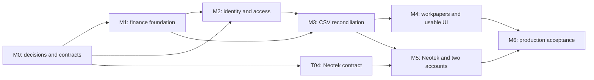

# Dike remaining work plan

Baseline review: **16 November 2026**. Updated **17 November 2026** to add [T42 Odoo connection/GL validation](T42_ODOO_VALIDATION.md) at the user's request and start its local secret setup. The baseline review used the source, all 11 files then present in `docs/delivery`, the [design draft](../../design_draft.md), and the supplied T01–T41 backlog identified in the [T01 manifest](T01_SOURCE_MANIFEST.json). This plan replaces the historical six-week timeline for remaining-work sequencing and estimates. [TASKS.md](TASKS.md) remains the task-status board; [CHECKPOINT.md](CHECKPOINT.md) is the latest implementation handoff; the [acceptance tracker](ACCEPTANCE_TRACKER.md) covers AC01–AC44 and the added OD-01–OD-08. The initial task addition changed planning only. The subsequent local secret setup passes a clean isolated build and 14 synthetic configuration checks; historical application checks below were not rerun for that change.

## 1. Current position

**The project is a locally working foundation with substantial finance implementation still outstanding.** There are **42 tasks: 1 done, 10 in progress and 31 pending**. Forty-one tasks still have unmet exit criteria. These counts describe deliverables, not a percentage of effort or production readiness.

| State | Tasks | Interpretation |
| --- | --- | --- |
| Done | T01 | Inventory and historical baseline completed to their stated scope. |
| In progress | T02–T06, T14, T26, T27, T37, T42 | Prepared contracts/decisions or bounded implementation exist; each task still has a material exit gap. T42 has local secrets, a read-only sample client and live synthetic fixture evidence; full extraction, comparison and acceptance remain pending. |
| Pending | T07–T13, T15–T25, T28–T36, T38–T41 | End-to-end deliverables have not been completed. Independent improvements inside a future task do not close it. |

Implemented: direct company registration/login/profile setup; read-only company staff directory; encrypted company NetSuite configuration and manual account/GL collection; candidate query provenance and offline GL comparison; strict SAR money validation; deterministic scoped `sar-v2` matching and pure review rules. Current source also contains English/Arabic localization and language switching; the user's recent changes are part of this review baseline. Localization's complete visual/accessibility verification remains outstanding.

Missing: reviewed finance migrations and application persistence; approved provider identities/contracts; verification/recovery delivery, invitations, grants and MFA; durable jobs; CSV/Neotek ingestion; persisted proposals and transactional review; exceptions; complete workpapers; deployed monitoring, migration/restore and live finance acceptance. The worker remains disabled. Current staff authorization does not establish authorization for all other routes.

### Verification performed for this review

The subsequent 17 November Odoo implementation passes a clean seven-project build and 221 executable checks (63 Odoo plus the prior 158). Live authentication/discovery and synthetic GL samples succeeded; the [explicitly authorized AP/payment posting report](ODOO_AP_TEST_DATA_20261117.md) records the fixture data. This later evidence does not close T42's full acceptance gates or replace the baseline below.

The subsequent same-day [web conversion](../ODOO_WEB.md) moves the user workflow into four Dike.Web pages and binds the local key to T-sab. Final build, 49 HTTP checks and 44 Odoo browser checks pass. The standalone executable runner is now blocked by Windows security (`0x800700E1`); the previous 221 passes above are historical, and 24 newly added service cases compile but remain unexecuted. Resolve that local validation block before relying on the expanded executable suite. The basic web preview is implemented; durable extraction, full report comparison and production finance integration remain outstanding. Planning totals and finance gates are unchanged.

The following results belong to the **16 November planning review**. The latest checkpoint also records subsequent localization checks. No build, web or provider checks were rerun when adding T42 on 17 November.

| Evidence | Result and practical limit |
| --- | --- |
| Six-project build | **Pass, 0 warnings / 0 errors**, using isolated output and serialized build below. The first normal build failed because an existing process held a web output DLL. A first shared-output build succeeded with copy-contention warnings; the serialized invocation resolved those warnings. |
| Custom executable checks | **158 passed, 0 failed**: 56 domain, 31 NetSuite fixtures, 39 offline GL comparison, 32 isolated SQLite staff checks. [Run log](../../artifacts/planning-review-20261116/executable-checks.log). |
| NetSuite CLI checks | **10 passed, 0 failed**. [Run log](../../artifacts/planning-review-20261116/cli-checks.log). Synthetic files only; no live provider calls. |
| Candidate contract | Fresh generator output matches the saved JSON; independently recomputed SQL SHA-256 matches. Status remains `CandidateUnverified`. |
| Historical manifest | 59 unique listed paths exist; at review entry 23 hashes matched and 36 differed from T01. The external backlog hash still matches. T01 is a historical baseline, not a current-source manifest. |
| Prior web / browser evidence | 29 isolated web checks and limited staff pagination/desktop/mobile DOM checks are recorded in the earlier checkpoint. **Not rerun here**; exact-size screenshots and complete English/Arabic flow checks remain unverified. |
| Prior SQL evidence | Nine disposable LocalDB mechanism checks previously passed. **Not rerun here**; these do not exercise the application finance schema/services. |
| Planning consistency | Checked 14 Markdown documents and 186 local links/anchors; all 41 board tasks, 40 remaining-task plans, 44 acceptance cases and 11 decisions are present without duplicates. Estimate totals agree; dependency graph has no cycles; both delivery JSON files parse. |

Reproduction commands for the fresh checks:

```powershell
dotnet build Dike.slnx --no-restore -p:UseAppHost=false -p:OutDir=C:/Dike/artifacts/planning-review-20261116/ -m:1 -p:BuildInParallel=false
dotnet artifacts/planning-review-20261116/Dike.Tests.dll
powershell -NoProfile -ExecutionPolicy Bypass -File tests/netsuite-validation-smoke.ps1
```

The executable runner must actually run; a test-discovery result of zero tests is not equivalent. This review changed planning documents only. It did not change application source, apply migrations, inspect private user rows, enable the worker or perform live finance acceptance. Runtime configuration overrides and deployed infrastructure were not audited.

## 2. Review of every delivery file

| Reviewed file | Finding / treatment in this plan |
| --- | --- |
| [CHECKPOINT.md](CHECKPOINT.md) | Accurate about the latest staff deliverable and incomplete finance work. Add the new planning handoff and distinguish fresh checks from historical web/SQL evidence. |
| [TASKS.md](TASKS.md) | All 41 tasks present exactly once. Preserve statuses; strengthen the execution prerequisites identified below. |
| [T01_BASELINE.md](T01_BASELINE.md) | Preserve as historical. Its empty staff service, five projects and older test counts describe T01, not today's implementation. |
| [T01_SOURCE_MANIFEST.json](T01_SOURCE_MANIFEST.json) | Valid historical source fingerprints. Preserve unchanged; later source changes must not overwrite baseline evidence. |
| [T02_NETSUITE_VALIDATION.md](T02_NETSUITE_VALIDATION.md) | Offline preparation is useful and tested. Live authentication, query/key/scope proof and independent GL agreement still block closure. |
| [T02_CANDIDATE_CONTRACT.json](T02_CANDIDATE_CONTRACT.json) | Matches generated contract and digest. Do not promote its candidate line identity to an accepted schema constraint. |
| [T03_CSV_CONTRACT_REVIEW.md](T03_CSV_CONTRACT_REVIEW.md) | Complete preparation worksheet and 18 synthetic cases. Actual sample, identity/completeness and date decisions remain missing; examples are not importer tests. |
| [T04_NEOTEK_CONTRACT_REVIEW.md](T04_NEOTEK_CONTRACT_REVIEW.md) | Documents five provider-documentation differences and pending real-product evidence. This review relies on that recorded research; it does not revalidate the portal or select a subscription. |
| [T05_IDENTITY_SECURITY_OPERATIONS.md](T05_IDENTITY_SECURITY_OPERATIONS.md) | Directory implementation is verified; D01/D02/D09, named owners, service selections and production identity controls remain open. The 14 proposed security cases are not executed acceptance. |
| [T06_REVIEW_CONCURRENCY_WORKPAPER.md](T06_REVIEW_CONCURRENCY_WORKPAPER.md) | Pure-domain and synthetic SQL improvements are real. D03/D07/D08/D10/D11 and actual SQL service workflows remain open. Preserve `sar-v2` for new proposals. |
| [DELIVERY_REVIEW.md](DELIVERY_REVIEW.md) | Earlier seven-file review and precision fixes remain valid historical evidence. Its next steps and 81-check count are superseded by the current checkpoint and this plan. |

### Planning corrections

1. **Resolve prepared decisions instead of producing more decision packs.** T02–T06 already contain the needed worksheets. Record actual evidence, named owners and choices in those files.
2. **Make bank identity/date inputs explicit in T07.** T03 is required to finalize bank contracts and the migration. D05 may remain open during a CSV milestone if provider extensions stay versioned and unexposed; Neotek-specific acceptance still waits for T04.
3. **Complete evidence and authorization before operational publication.** T11 references verified immutable evidence; T14 needs the actual SQL authority boundary; T18/T19 need T16 for requester/service authorization and revocation.
4. **Implement active-review invalidation before exposing approvals.** T11 can be tested before review exists, but a release with active groups requires T30 inside the same publication transaction. T29 alone is not a safe launch milestone.
5. **Develop T37 throughout delivery.** Start harness preparation now, apply actual migrations at T08, and add service races with each feature. Nine mechanism probes are not a completed integration suite.
6. **Use `sar-v2` for new persisted proposals.** The external backlog and older design file list still mention `sar-v1`; retain it only on historical evidence. Extend the existing Staff pages instead of recreating them.
7. **Do not treat a polling interval as selected.** The old implementation plan's conditional 15-minute example is not an approved schedule; D05 and provider limits determine it.
8. **Include current bilingual UI in T36.** Verify English and Arabic/RTL forms, tables, focus, validation and mobile layouts. Reconfirm actual rendered dimensions in screenshot evidence.

## 3. Scope and delivery milestones

The full initial release remains one pilot company, one subsidiary, the primary book, two distinct SAR bank/GL mappings and an agreed statement period. Isolation is still proven with two synthetic companies. Preserve direct ASP.NET Core Identity and the existing Razor application.

**Added Odoo scope:** T42 establishes an additional accounting-source connection and validation path alongside T02. It requires its own actual company/ledger semantics and OD-01–OD-08 evidence; Odoo must not be forced into fabricated NetSuite book identifiers. Finalizing Odoo-specific T07 contracts depends on T42, while the existing NetSuite/CSV path may proceed independently. Production Odoo UI, durable publication and downstream workflow integration require a separately scoped follow-up estimate; this addition does not replace NetSuite or waive its release gates.

Payment initiation, automatic journals, NetSuite reconciliation writeback, partial allocations, N:N/mixed-direction allocation, multicurrency consolidation, forecasting, holiday calendars and new authentication modes remain outside this plan. A scoped change requires a separate estimate and acceptance revision.

| Milestone | Work included | Exit evidence |
| --- | --- | --- |
| M0 — Decisions and source contracts | Close T02/T03/T05/T06; pursue T04 and T42 independently | Named decisions and verified inputs sufficient for schema, identity and CSV work. T04 may remain open for the internal CSV milestone only; T42 gates acceptance of Odoo-specific source contracts. |
| M1 — Persisted finance foundation | T07–T12; T37 schema/query/publication checks | Reviewed disposable SQL migration; tenant constraints; canonical identities, immutable revisions, safe publication and protected evidence. |
| M2 — Controlled staff access | T13–T16, coordinated with M1 | Verified staff can receive invitations and use approved grants/MFA; revocation and last-admin cases pass. |
| M3 — Internal CSV reconciliation | T17–T23 and T26–T33, including T30 | One verified GL account plus approved bank CSV; two distinct staff; submit/approve/return/reopen/correction flow; all relevant SQL races pass. Restricted internal milestone, not full release acceptance. |
| M4 — Complete reproducible evidence | T34–T36 and associated T37 checks | Approved full CSV/JSON workpaper, immutable capture, secure delivery, correct period/full-group arithmetic and usable UI. |
| M5 — Both source paths and accounts | T04/T24/T25 and integration into M3/M4 | Actual Neotek consent, transactions/balances/corrections accepted; both pilot accounts remain isolated and reproducible. |
| M6 — Release acceptance | T38–T41 and completion of T37 | Recovery and migration rehearsed, D10 benchmark accepted, AC01–AC44 disposition recorded and named signoffs present. |



The graph shows milestone gates, not a requirement to finish every item in a milestone before starting independent work. The task prerequisites below control execution. The likely longest chain is source identity/technical decisions → schema → publication/access → ingestion → transactional review/invalidation → exports/UI → recovery/benchmark → acceptance. A late Neotek contract can become the controlling dependency for full release.

## 4. Decision and external-input queue

All named owners remain **unassigned**. Assign a delivery lead, technical lead, integration engineer, finance owner/reviewer, security owner, operations owner and product reviewer; one person may cover several delivery roles, subject to the required independent finance/security reviews. A role label is not a signoff.

| Gate | Proposed disposition or required input | Accountable role | Required before |
| --- | --- | --- | --- |
| NetSuite / T02 | Actual company/connection/subsidiary/book/account/period, Records Catalog, independent full GL report and named finance reviewer. Run existing comparison; approve query/key only after real evidence. | Integration + finance | T07 final keys, T20 and live release |
| Odoo / T42 | Actual version/hosting/API access, trusted endpoint/database and service identity, company/bank GL/report scope, installed schema and independent GL report. Build the validation client and record OD-01–OD-08 evidence. | Integration + finance, with security review | Odoo-specific T07 contracts and any later production Odoo integration |
| D01 | T05 recommends SQL Server Identity for production with preserved IDs/hashes/stamps and an explicit shared transaction. Restricted SQLite pilot is an alternative requiring split-store revocation. Select topology and migration route. | Technical + security | T13 lifecycle schema; T14/T16 authority boundary |
| D02 | Select audited delegation or independent sensitive-assignment review; confirm MFA population, bootstrap, recovery, last-admin and token/step-up values. T05 recommends independent review when staff are available. | Finance + security | T13–T16 enforcement |
| D03 | T06 recommends immutable revisions and ordered SQL account guards. Select actual keys/lock order, authority boundary and conflict behavior. | Technical | T07–T11, T17, T27–T30 |
| D04 | Representative bank export plus repeat/reordered/corrected/full/partial samples; choose defensible bank ID or statement-line identity. No amount/date hash fallback. | Finance + provider | T07 bank contracts, T10, T22/T23 |
| D05 | Actual Neotek subscription/version, corporate banks, consent/profile mode, N01–N05 resolutions, pages/IDs/corrections/history/quotas and cadence evidence. | Integration | T24/T25 and live scheduling |
| D06 | Approve booking/value comparison field, exact formats, source timezone, missing-value behavior and filter boundaries. Preserve both source dates. | Finance | Bank contracts/normalization, T26, T35 |
| D07 | T06 recommends release of reservations on Return/Reopen. If holds are chosen, specify ownership, expiry, withdrawal and takeover. | Finance + technical | T27–T30 lifecycle |
| D08 | T06 recommends an unresolved documented SAR 50 exception when no genuine eligible source group exists. Accept that outcome or supply verified source correction; mixed-direction allocation changes scope. | Finance | AC33 / T41 closure |
| D09 | Select host/replicas, SQL/authentication, trusted origin/proxies, delivery sender/provider, evidence/secret/key services, access, retention/holds, RPO/RTO and restore/alert owners. | Operations + security | T08 deployment target; T12/T13 services; T38/T39 |
| D10 | Agree rows/history/accounts/concurrency, host hardware and numerical latency/import/export/resource targets. | Product + operations | Capacity design and T40 acceptance |
| D11 | T06 recommends separate CSV tables plus JSON/manifest. Approve fields/masking, complete group membership, period totals, immutable review/audit capture and signoff format. | Finance | T07 export references, T34/T35 |

Use one recorded decision per ID with choice, owner, date, evidence and affected tasks. Credentials belong in the selected application/secret store. Sample references and hashes can be recorded in the review packs; real financial data should not be copied into repository planning files. Previously missing NetSuite/CSV inputs remain missing until evidence arrives; an unanswered request or instruction to continue does not select a business policy.

## 5. Task-by-task execution plan

Effort is **remaining focused engineer-days**, estimated from the inspected implementation. It includes routine implementation checks and documentation, but excludes external waits, reviewer availability, significant rework and separately scoped migration/provider surprises. Estimates are planning judgments, not measured completion promises. Priority P0 = unblock contracts/decisions; P1 = integrity/access foundation; P2 = usable reconciliation and evidence; P3 = release closure. Operations and tests start early despite their final closure priority.

### WP0 — Close contracts and decisions: 8–16 days

Lead: integration/technical; reviewers: finance, security, operations and product as listed above. T01 is already done and has zero remaining implementation effort.

| Task | Prerequisites | Remaining action | Exit / acceptance evidence | Days |
| --- | --- | --- | --- | --- |
| T02 · P0 | T01; real NetSuite inputs | Verify live authentication, scope/joins/key cardinality; compare full report/extract and repeat observation; record accepted versions and reviewer. Reuse existing offline tool. | AC08/09; zero unexplained row/debit/credit differences, accepted identity and negative scope cases. | 1–3 |
| T42 · P0 | T01; actual Odoo version/access/report inputs | Confirm API/schema/scope (1d); implement minimal read-only connection/full reader (1–2d); Odoo-aware comparison/fixtures (1–2d); live agreement/signoff (1d plus wait). See [T42](T42_ODOO_VALIDATION.md). | OD-01–OD-08: verified source identity, complete posted SAR GL extract and independent row/debit/credit agreement. Production integration is a separate follow-up. | 4–6 |
| T03 · P0 | T01; bank samples | Complete existing format worksheet, prove genuine duplicate/replay/replacement behavior and approve D04/D06 with actual dates. | Versioned CSV contract with named finance/provider review. | 1–2 |
| T04 · P0 | T01; provider evidence | Resolve N01–N05, pin subscribed schema and capture authorized consent/page/correction examples; document unsupported capabilities. | D05 accepted; evidence usable by T24/T25. | 1–3 |
| T05 · P0 | T01; named decision owners | Record D01/D02/D09 and concrete service/migration/recovery values in the existing pack. | Decisions complete; no unowned production controls. | 0.5–1 |
| T06 · P0 | T01; named decision owners | Record D03/D07/D08/D10/D11; approve lock ordering, lifecycle, workpaper arithmetic and workload. | Reviewed choices and acceptance examples; no inferred fee or performance SLA. | 0.5–1 |

### WP1 — Finance data and publication: 13–19 days

Lead: backend/technical; reviewers: technical, security and finance for source semantics. Main locations: `Dike.Core`, `Dike.Infrastructure/DikeDbContext.cs`, and planned persistence/ingestion/evidence services. Planned file names in the draft are guidance; migration names must be generated for the actual implementation.

| Task | Execution prerequisites | Remaining action | Exit / acceptance evidence | Days |
| --- | --- | --- | --- | --- |
| T07 · P1 | T02,T03,T05,T06; T42 for Odoo-specific contracts | Define canonical company/connection/account keys; connections/mappings; source runs/pages/coverage; logical movements/revisions/snapshot members; grants/jobs/groups/reservations/idempotency/exceptions/evidence/export contracts. Include nullable balance as-of and separate fetched time; version Odoo additions after T42. | Reviewed entity/key/constraint map; no replaceable mapping in logical reservation identity; typed relationships and material-change rules. Existing estimate covers the original scope; substantial Odoo schema integration is re-estimated separately. | 2–3 |
| T08 · P1 | T07; SQL target decision | Implement mappings/constraints and finance baseline; review generated SQL and test disposable creation/upgrade. Plan populated Identity adoption separately under D01. | Actual application migration succeeds; cross-tenant and revision/member FK violations fail; history cannot cascade-delete. | 2–3 |
| T09 · P1 | T08 | Scoped current/history queries; provision canonical resource guards; deterministic multi-resource/authority lock order and conflicts. | Real SQL isolation, missing-guard and competing-write tests through application services. | 2–3 |
| T10 · P1 | T03,T08 | Stage immutable observations/memberships and consecutive unchanged replay; retain correction/removal history and A→B→A. | AC12/18 fixture + SQL cases; no duplicate logical rows or rewritten historical revisions. | 2–3 |
| T11 · P1 | T09,T10,T12 | Build publication (1–2d) and coverage/removal/failure handling (2d). Verify staged evidence, advance complete current pointers atomically; provide the shared transaction seam for T30 invalidation. | Incomplete/failed/narrow/delta inputs preserve current state; complete equivalent empty scope is supported; no publication references missing evidence. Active-review rollout also requires T30. | 3–4 |
| T12 · P1 | T05,T08 | Private immutable evidence service, digest/length/version verification, scoped retrieval interface and credential/evidence separation; integrate selected storage/key services. | Foreign/arbitrary-path/secret-archive retrieval denied; corrupt or missing evidence blocks reference/publication. Full user grant enforcement closes with T16. | 2–3 |

### WP2 — Identity and authorization: 10–15 days

Lead: backend/web; reviewers: security, finance and operations. Extend the existing authentication and Staff implementation; preserve populated Identity and registration atomicity.

| Task | Execution prerequisites | Remaining action | Exit / acceptance evidence | Days |
| --- | --- | --- | --- | --- |
| T13 · P1 | T05 | Delivery adapter/outbox or equivalent durable delivery, trusted-origin links, expiring bound verification/reset tokens, resend/retry/throttling and a staged path for existing unconfirmed owners. Adopt the selected Identity schema safely. | AC01–03: expired/replayed/cross-user tokens and enumeration fail; delivery failure never falsely verifies a user; populated-copy sign-in works. | 2–3 |
| T14 · P1 | T05,T07,T09,T13 | Invitations/acceptance (1d); controlled roles/grants/delegation and audit (1–2d); authority-version revocation/last-admin serialization (1–2d). Add actions to the current read-only directory. | Two distinct eligible staff; cross-company/self-escalation denied; concurrent last-admin and revocation/commit ordering pass. | 3–5 |
| T15 · P1 | T13,T14 | MFA enrollment/challenge and replay control (1–2d); recovery/step-up (1d); abuse/emergency/last-admin operational cases (1d). | AC04 and remaining AC02: partial MFA sessions denied; concurrent code reuse has at most one success; recovery cannot restore revoked grants. | 3–4 |
| T16 · P1 | T09,T12,T14 | Apply current membership/role/account/action grants across existing and future routes, counts, jobs, mapping changes and artifact delivery; establish service-job policy and transactional authority checks. | AC05/06/36: two companies and two accounts; Administrator is no finance bypass; revoke after enqueue/generation and before commit/delivery denies stale authority. | 2–3 |

### WP3 — Durable jobs: 6–9 days

Lead: backend/worker; reviewers: technical and operations. Implement shared infrastructure before replacing the disabled worker lifecycle.

| Task | Execution prerequisites | Remaining action | Exit / acceptance evidence | Days |
| --- | --- | --- | --- | --- |
| T17 · P1 | T08,T09 | Atomic SQL claim/reclaim/renew, owner/generation/expiry using database time, eligible-job indexes and account serialization. | Competing workers claim once; expired owner cannot renew or overwrite replacement outcome. | 2–3 |
| T18 · P1 | T16,T17 | Bounded total retry, Retry-After rescheduling, credential/consent pause, persisted cancellation and current authority checks. Define configurable schedule/overlap/full-refresh policy without selecting unapproved cadence. | AC29/30: cancellation/renewal races and permanent failures are safe; one retry budget across job and adapter. | 2–3 |
| T19 · P1 | T11,T12,T16,T17,T18 | Coordinator/worker integrates staging, verified evidence and final publication fence; safe shutdown, reclaim and scheduler duplicate prevention. | AC28–31: injected pre/post-commit crashes, old mapping/connection, revoked requester and lost lease cannot create stale/duplicate publication. | 2–3 |

### WP4/WP5 — Source adapters: 13–20 days

Lead: integration; reviewers: finance and technical. NetSuite and CSV form the first internal workflow; Neotek development can proceed independently once its own gates are met.

| Task | Execution prerequisites | Remaining action | Exit / acceptance evidence | Days |
| --- | --- | --- | --- | --- |
| T20 · P1 | T02,T12,T19 | Adopt verified query/key, scoped reader factory and connection/mapping revisions; retain every page/run; finish auth/redirect/paging negative cases and publish through coordinator. Reuse strict money checks. | AC07–10/12/13/31/32: full collection or no current-state change; scope/key/sign/precision/page failure rejects entire run. | 2–3 |
| T21 · P2 | T20 | Disjoint period partitions with parent manifest, exact boundaries, aggregate completeness and minimum-partition cap rejection. | AC11: no gaps/overlap loss; failed child prevents parent publication; too-large single day fails explicitly. | 2–3 |
| T22 · P1 | T03,T12 | Approved CSV grammar and diagnostics, exact dates/money/IDs, upload limits, protected original, whole-file validation and useful row errors. | AC13/17: representative approved sample passes; malformed/oversize/foreign/ambiguous identity input fails before publication. | 2–3 |
| T23 · P1 | T10,T11,T16,T22 | Account-authorized upload/import service connects CSV to common staging/publication; implement declared scope, idempotent replay and replacement rules. Use T19 if upload processing is queued. | AC12/18/32: equal-looking distinct rows survive; failed/replayed/partial/full-replacement cases preserve correct current state and history. | 2–3 |
| T24 · P2 | T04,T12,T16 | Contract-specific token/consent/profile/account discovery (1–2d); typed balances and authorization UI (1–2d). Bind callbacks/state using the actual provider contract. | AC14/16: app token does not imply consent; foreign/revoked links denied; balance type/currency/as-of/fetch time remain separate. | 2–4 |
| T25 · P2 | T19,T24 | All-page transactions/normalization (1–2d); common publication, replay/corrections/history and approved scheduling (2d). | AC12–16/18/30: actual-bank evidence plus fixtures; no guessed changed-ID linkage; failed pages/consent loss preserve last success. | 3–4 |

### WP6 — Reconciliation and exceptions: 12–18 days

Lead: backend/web; reviewers: finance and security. Pure `sar-v2` and review guards already exist; the remaining work is their authoritative persisted workflow.

| Task | Execution prerequisites | Remaining action | Exit / acceptance evidence | Days |
| --- | --- | --- | --- | --- |
| T26 · P2 | T20,T23 | Persist deterministic proposals/candidates pinned to exact source snapshots, mapping/date/rule versions; omit ineligible/reserved rows; expose adjacent coverage limits. | AC19/20: persisted output reproducible under input order changes; finance-approved date boundaries; current scope retained. | 1–2 |
| T27 · P2 | T06,T08,T09,T10 | Immutable draft/group revisions and complete member pins; current-source validation for existing/removed/booked/revision/scope state; explicit D07 lifecycle. | AC21: valid whole-row groups pass; stale/removed/partial/N:N/zero/mixed-sign/cross-scope members fail. | 2–3 |
| T28 · P2 | T09,T16,T27 | Submission/reservation transaction (1–2d); actor/action/resource/payload-bound idempotency and atomic result/audit (2d). Reserve stable logical movements. | AC23/27: one winner for shared members; full rollback on fault; same request replays after reauthorization; changed request conflicts. | 3–4 |
| T29 · P2 | T28 | Distinct authorized Controller approve/return/reopen with expected versions, reasons and immutable transition history; D07 release/hold behavior. | AC22/26/27: dual-role/self approval denied; stale evidence conflicts; retries create one transition. | 2–3 |
| T30 · P1 | T11,T29 | Integrate changed/removed-source invalidation, reservation release, audit/exception creation and stale drafts into publication's transaction. | AC24/25/31: both approval/publication orderings and injected failures pass actual services; no stale active approval survives publication. | 2–3 |
| T31 · P2 | T14,T30 | Scoped exception ownership, immutable notes/events/links, resolution/reopen and eligibility checks; support accepted D08 outcome. | AC33/34: full investigation history; resolving an exception cannot approve a group or fabricate a fee. | 2–3 |

### WP7 — UI and workpapers: 11–16 days

Lead: web/backend; reviewers: product, finance and security. Retain the current Razor stack and language support.

| Task | Execution prerequisites | Remaining action | Exit / acceptance evidence | Days |
| --- | --- | --- | --- | --- |
| T32 · P2 | T16,T19,T20,T23; T24 for provider balances | Account/period overview, separate bank/book coverage and totals, typed balances/unknown-as-of, last success versus latest failure, job state and pagination. | AC16/32: truthful empty/stale/failure states; account-granted totals; finish Neotek balance integration after T24. | 2–3 |
| T33 · P2 | T26,T29,T31 | Reconciliation grids/grouping (2d); Controller/exception/history and recoverable conflict screens (1–2d). Send expected versions and idempotency keys. | Representative two-user flow works; stale actions never silently reload and commit; account permissions apply to grids and actions. | 3–4 |
| T34 · P2 | T06,T12,T16,T30 | Capture immutable export inputs from one SQL boundary, pin source/group/transition/audit state and create manifest; serialize outside guard; reauthorize delivery. | AC35/36/41: concurrent source/review changes cannot mix generations; original capture remains reproducible. | 2–3 |
| T35 · P2 | T34 | Approved complete CSV/JSON package, digests/counts/totals/masking, full membership with out-of-period flags, safe CSV text and unchanged numeric money. | AC35/37/41: exports exceed UI preview safely; period totals and full-group balance remain separate; finance accepts schema and sample. | 2–3 |
| T36 · P2 | T32,T33,T35 | English and Arabic/RTL keyboard, screen-reader, focus/validation, responsive long-table/form audits; fix defects and obtain correctly sized screenshots. | AC38: representative authenticated paths pass in both languages; browser/DOM/screenshot evidence agrees. | 2–3 |

### WP8 — Integration and release: 13–20 days

Lead: technical/operations; reviewers: security, finance and product. T37 and T38 progress with feature work; they are not deferred to the last week.

| Task | Execution prerequisites | Remaining action | Exit / acceptance evidence | Days |
| --- | --- | --- | --- | --- |
| T37 · P1 | T08; extend through T35 | Actual-migration disposable SQL harness (1–2d); service race suite (1–2d); fault/revocation/export/cancellation/replay integration (2d). Keep the existing mechanism probe as supporting evidence. | AC05/06/18/23–29/31/36/41 exercised through actual code, with deterministic coordination, bounded timeouts and verified cleanup. | 4–6 |
| T38 · P1 | T05,T19 | Sanitized readiness and structured correlation/state/timing logs; queue/lease/evidence/key/backup alerts and named responders. Validate deployment/proxy/key isolation. | AC42: no secrets/raw bodies in logs/health/errors; liveness separate from readiness; alerts actionable without provider calls on every probe. | 2–3 |
| T39 · P3 | T12,T15,T30,T35,T38 | Pilot/Identity migration dry run (1–2d); preserved-copy cutover/rollback plan (1d); full-store/key restore rehearsal (1–2d). Validate later revocations and safe job restart. | AC39/43: counts/totals/history/decryption/authority preserved; measured RPO/RTO; originals retained; source timestamps/signoff never invented. | 3–5 |
| T40 · P3 | T06,T36,T37 | Run agreed workload on selected hardware; capture latency/import/export/memory/SQL contention and repeatability. Re-estimate material remediation separately. | AC40: numeric D10 targets met and product/operations reviewer accepts measured results. | 2–3 |
| T41 · P3 | T02,T15,T21,T25,T36–T40; all required AC gaps closed | Execute two-account statement/GL acceptance, negative authorization, documented SAR 50 outcome and operational handover. Finish runbooks and evidence index. | AC01–AC44 assessed; required live gates signed; no unresolved release blocker; named finance/security/operations/product dispositions. | 2–3 |

Substeps in parentheses split tasks above three days into reviewable pieces. Each substep must produce code/configuration, evidence and a short result record; a partial task stays in progress until its whole exit criterion is met.

## 6. Estimate, staffing and schedule

The external backlog totals **83–107 engineer-days**, including completed T01. Removing only T01 leaves **82–106 days before credit for partial work**. The 16 November remaining-work estimate was **82–127 engineer-days**. Adding T42's **4–6 days** gives **86–133 engineer-days** for the currently defined tasks. Prepared comparison/decision work and pure rules reduce some work; Identity coordination, application SQL races, recovery and uncertain provider contracts widen other ranges. T42 includes a new validation client because no Odoo adapter exists; full production Odoo integration is outside this increment and must be scoped after its contract is known.

| Work package | Remaining days |
| --- | --- |
| WP0 contracts/decisions, including T42 | 8–16 |
| WP1 finance/publication | 13–19 |
| WP2 identity/access | 10–15 |
| WP3 worker | 6–9 |
| WP4/WP5 adapters | 13–20 |
| WP6 review/exceptions | 12–18 |
| WP7 UI/workpapers | 11–16 |
| WP8 integration/release | 13–20 |
| **Total, each task counted once** | **86–133** |

At one engineer contributing four focused days per week, this is approximately **22–34 working weeks**, before external waits and substantial rework. The old six-week estimate is not a credible commitment for the documented remaining scope. Do not assign a completion date until staffing and M0 inputs are available. If a budget allowance is required, add a separately visible contingency, for example 20% (**about 104–160 engineer-days in total**, rounded up); this is a planning allowance, not a forecast or approved budget.

With multiple engineers, separate identity/web, persistence/worker/review and provider integration work after agreeing shared contracts. SQL guard/publication changes need one coordinating technical owner. Parallel development reduces elapsed time only where prerequisites permit; no additional staffing or agent delegation is assumed here. Finance/security/operations review time must be scheduled separately.

Re-estimate after M0, after actual-migration/race proof at M1, and after the first complete M3 workflow. A complex populated Identity migration, provider identity failure, absent CSV identity, changed D08 scope, unsupported Neotek capability or capacity remediation requires a visible estimate revision, not hidden overtime inside T41.

## 7. Next ten engineering days

This is a conditional starting sequence, not a promised calendar. Continue the ready work if owners or external data are delayed; do not substitute mock evidence for acceptance.

| Window | Main work | Result to review |
| --- | --- | --- |
| Day 1 | Assign owners; use existing T05/T06 packs to decide D01/D02/D03/D07/D08/D09/D10/D11; request existing NetSuite/CSV/Neotek evidence and T42 Odoo version/hosting/report inputs through responsible owners. | Decision entries and missing-input owners/dates; first implementation slice selected. |
| Days 1–2 | Prepare T37 actual-service test harness scaffolding and repeatable source/build evidence; define T13 provider-neutral delivery/token seams and synthetic failure cases. | Runnable baseline command and reviewable tests/contracts that do not enforce an unchosen policy or alter real users. |
| Days 2–4 | If T02/T03/T05/T06 close, execute T07. In an independent lane, implement T13 once its specific choices/services are selected. | Reviewed canonical model or verification/recovery slice with isolated checks. |
| Days 5–7 | T08 reviewed disposable SQL baseline and T37 constraint/tenant checks. Start T12 against selected private storage/key boundaries. | Actual schema proof and protected evidence contract. |
| Days 8–10 | T09 guard/query proof; start T10 immutable staging; extend T14 only when its scope/delivery/authority prerequisites exist. | First safe persisted-data slice and actual-service concurrency evidence. |

**Ready now without business-policy selection:** prepare the test harness and fail-fast runner/reporting, preserve source/build fingerprints while no Git metadata exists, define provider-neutral delivery interfaces and test doubles, prepare negative fixture matrices from the existing packs, and document observed localization coverage. Implement these in later execution work; this turn delivers the review and plan.

**Requires recorded choices or real inputs:** production Identity migration; live delivery/enforcement; sensitive staff assignments/grants; canonical provider keys and bank date/removal rules; provider integrations; production scheduling/storage/retention; final finance/export/capacity acceptance. Keep current unconfirmed owners and encrypted evidence usable through the staged migration. Do not recreate populated stores or use initial migrations blindly.

## 8. Acceptance, risks and handover

The [acceptance tracker](ACCEPTANCE_TRACKER.md) maps every AC01–AC44 and the added Odoo cases OD-01–OD-08 to evidence, remaining proof, tasks and reviewer roles. No full-release or Odoo case is newly signed off by planning. For each implementation slice, record source/build fingerprint, test environment, exact command, result, protected evidence reference, limitations and reviewer/date where required.

| Risk | Early test / mitigation | Escalation point |
| --- | --- | --- |
| Candidate NetSuite identity or query is wrong | T02 actual Records Catalog/report comparison before T07 final keys | Stop that provider's dependent schema/adapter activation; version and re-estimate affected work. |
| Odoo API/permissions/ledger semantics differ from assumptions | T42 installed-schema inspection, company-scope negatives and independent complete GL comparison | Keep the Odoo contract candidate; re-estimate unsupported transport/custom-module or production-integration work. |
| CSV has no stable identity/completeness | T03 real duplicate/replay/overlap examples | Obtain a supported export or explicitly revise scope; no heuristic deduplication. |
| Neotek access/contract differs from documentation | T04 resolves N01–N05 and actual-bank eligibility | Internal CSV milestone may proceed; full release remains blocked or requires an explicit scope change. |
| Authority and finance commits disagree | T09/T14/T16 revocation fence plus T37 crash/race cases | Keep affected finance actions disabled until ordering is proven. |
| Approval/publication/reservation races | Test actual services as T28–T30 land, before final UI polish | Treat stale active approval/double reservation as release blocking. |
| Keys or populated stores cannot be recovered | Rehearse on copies during T12/T13 preparation; complete T39 | Preserve originals and defer cutover until restore/rollback works. |
| Source changes while no Git metadata exists | Capture scoped source hashes for each verified slice; repository setup can be a separate delivery hygiene task | Do not treat the old T01 manifest as the current release identity. |
| UI suggests unverified balances/coverage | Typed data, separate current/available/movement totals, explicit unknown/failure states; bilingual T36 | Finance/product correction before acceptance. |
| Scope or workload grows | D10 and boundary review at each milestone | Re-estimate explicitly; keep public production dates unset until gates clear. |

Required runbooks at handover: registration/verification/invitations/grants/MFA/recovery; mapping and provider consent/credential rotation; import/retry/cancel/failed coverage; review/return/reopen/invalidation/exceptions; workpaper generation and authorized retrieval; alert triage; migrations/rollback; full-store/key restore and retention/holds. Finish each alongside its implementing task, then exercise it at T39/T41.

After each verified slice, update the task board, acceptance tracker and checkpoint. A task becomes Done only when its deliverable and exit evidence are complete. Live provider/finance/operations approvals remain explicit records. Keep historical T01 and delivery-review evidence unchanged.
